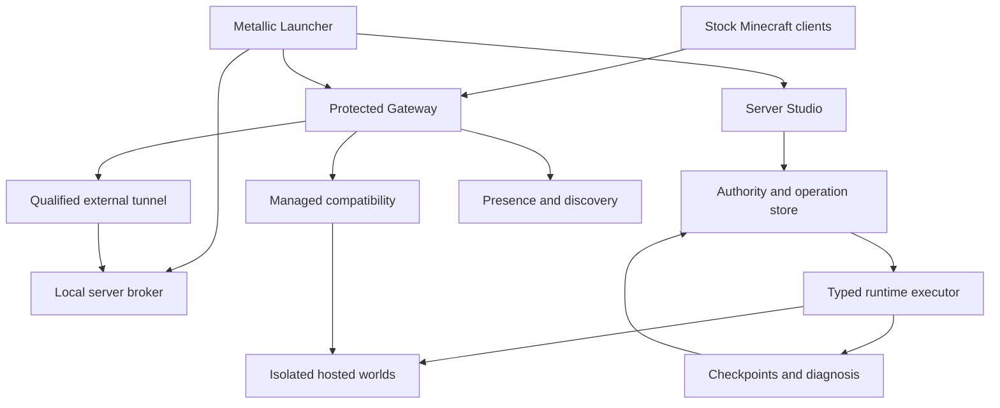

# Metallic-MC — Master Product and Engineering Draft

**Brand:** Metallic  
**Project:** Metallic-MC  
**Repository:** [oncoursemail/Metallic-MC](https://github.com/oncoursemail/Metallic-MC)  
**Document status:** DRAFT — consolidated owner requirements, researched architecture, implementation status, and delivery criteria.  
**Prepared:** October 20, 2026, America/Chicago.  
**Implementation baseline:** [`8f513fe`](https://github.com/oncoursemail/Metallic-MC/commit/8f513fe17955b8718f12f91a0f41144524764400), including [custom network PR #28](https://github.com/oncoursemail/Metallic-MC/pull/28) and [launcher/hosting foundation PR #29](https://github.com/oncoursemail/Metallic-MC/pull/29).

This is the single reading entry point for the Metallic-MC vision discussed with the owner. It brings the launcher, local server manager, managed hosting service, original Minecraft network, custom software, games, creator experience, security, operations, and research into one draft. The detailed documents linked below retain the exact contracts, source evidence, and validation records.

**Current reality:** the repository contains a working private control foundation, original offline network components, private staging and recovery tooling, inventory/lifecycle/population planners, an offline crash analyzer, and an authenticated Server Studio. It does not yet contain a completed desktop Minecraft launcher, playable custom proxy, production tenant executor, live public directory, or released original game/resource-pack suite. A proposed feature, passing unit test, and deployed service are separate states throughout this document.

## Contents

1. [Purpose and settled decisions](#1-purpose-and-settled-decisions)
2. [Owner requirements and product scope](#2-owner-requirements-and-product-scope)
3. [Four operating modes](#3-four-operating-modes)
4. [Core user journeys](#4-core-user-journeys)
5. [Metallic launcher](#5-metallic-launcher)
6. [Original system architecture](#6-original-system-architecture)
7. [Gateway, multiple proxies, transport, and protected ingress](#7-gateway-multiple-proxies-transport-and-protected-ingress)
8. [Authority and permissions](#8-authority-and-permissions)
9. [Presence, TAB-style displays, and visibility](#9-presence-tab-style-displays-and-visibility)
10. [Server engines and Paper compatibility](#10-server-engines-and-paper-compatibility)
11. [Mandatory managed compatibility](#11-mandatory-managed-compatibility)
12. [Tenant isolation and network containment](#12-tenant-isolation-and-network-containment)
13. [Sync Now and world ownership](#13-sync-now-and-world-ownership)
14. [Authentic population evidence and bot resistance](#14-authentic-population-evidence-and-bot-resistance)
15. [Server management, console, files, and administration](#15-server-management-console-files-and-administration)
16. [Backups, recovery, and power-loss behavior](#16-backups-recovery-and-power-loss-behavior)
17. [Metallic Games and the creator platform](#17-metallic-games-and-the-creator-platform)
18. [Visual identity, interfaces, and resource packs](#18-visual-identity-interfaces-and-resource-packs)
19. [Diagnostics and controlled repair](#19-diagnostics-and-controlled-repair)
20. [Moderation, privacy, and platform rules](#20-moderation-privacy-and-platform-rules)
21. [Infrastructure, resource management, and Star AI](#21-infrastructure-resource-management-and-star-ai)
22. [Implemented status and verification](#22-implemented-status-and-verification)
23. [Delivery sequence and proof of improvement](#23-delivery-sequence-and-proof-of-improvement)
24. [Open decisions and release blockers](#24-open-decisions-and-release-blockers)
25. [Detailed documents and primary sources](#25-detailed-documents-and-primary-sources)

## 1. Purpose and settled decisions

Metallic should make playing, creating, hosting, understanding, moving, and recovering a Minecraft server feel like one coherent product. It should offer polished first-party games and a strong community creator platform while preserving the independence of local private servers.

The owner wants original software that can improve on Velocity, LuckPerms, TAB, Paper/Folia, and the overall Minehut/MineKeep/Mineclub experience. The engineering commitment is to own the product-specific behavior and prove improvements through equivalent-work comparisons. This draft does not declare universal superiority, zero latency, unlimited capacity, perfect compatibility, or an unhackable host.

Settled decisions:

- **Metallic** is the player-facing brand. **Metallic-MC** is the project/repository name.
- The shared Metallic launcher offers projects/components separately. Selecting MC must not require installing RC, RB, or unrelated content.
- The Minecraft launcher remains optional for ordinary supported Minecraft connections.
- Local private servers remain independent, with no mandatory platform registration, plugin, agent, directory listing, or cloud telemetry.
- Explicit sync creates or updates a separate managed hosted copy. Hosted private servers still follow hosting rules.
- Public participation adds network and discovery rules, whether the server is hosted by Metallic or connected through an external tunnel.
- Required compatibility is a managed capability with protected artifacts and admission checks.
- Public counts come from trusted session observations, never a tenant-editable ping number.
- Metallic-MC and the other Metallic project require separate project containers. Tenant isolation adds another boundary inside the MC hosting design.
- Legacy Wings/Old Servers on Brain 2 remain outside this rollout.
- Existing dashboards and the prior UI alternatives remain available until an actual visual selection is made.
- The owner's Minecraft EULA acceptance has already been recorded for the private pilot. It is not the remaining pilot blocker and is not requested again here.

The owner-designated family domain is **Metallic.club**. Recording that identity does not configure DNS, publish a service, or establish a protected edge. See [project identities](docs/PROJECT_IDENTITIES.md).

## 2. Owner requirements and product scope

| Requirement | Product interpretation | Completion evidence |
| --- | --- | --- |
| Own Minecraft launcher | Install, repair, select, authenticate, and launch qualified client profiles | Entitled real-account launch and supported-device checks |
| Personal server manager | Local start/stop/restart, console, files, profiles, diagnosis, backups | Real local process ownership and recovery |
| Better hosting experience | Managed private/public servers, clear limits, useful tools, understandable failures | Complete owner workflows on isolated infrastructure |
| Own proxy/network software | Routing, multi-gateway fleet, authentication, transfers, budgets, admission | Real online client and secure backend-switch tests |
| Better permissions and TAB behavior | Shared authoritative policy and player context with explanations and controlled rendering | Migration comparisons and per-viewer packet tests |
| Own server software with plugin support | Qualified Paper-compatible profile plus a separate authored-game runtime track | Published API/plugin/mechanics conformance matrix |
| Older Java versions and Bedrock | Explicit protocol, edition, transport, gameplay, and visual support tiers | Real client matrix with known limits |
| Compatibility cannot be deleted | Managed artifacts outside tenant-writable data; verified admission | Deletion/tampering/rebuild tests on real hosted profiles |
| Safe Sync Now | Reviewed checkpoint transfer, destination conflict handling, isolated verification, rollback | Interruption and stale-writer tests |
| Tenants cannot attack siblings or host | Workload, filesystem, network, credential, and resource boundaries | Negative cross-tenant tests and ongoing patching |
| No fabricated popularity | Gateway-sourced bounded-age observations; separate bot/ranking controls | Replay, expiry, transfer, and manipulation tests |
| Complete admin controls | Scoped suspend/delete/reinstate, containment, audit, retention, and appeal | Authorized and unauthorized operation tests |
| Games first, community next | Metallic Games precede community discovery without invented activity | Real released content and reviewed listings |
| Premium club-like visuals | Original Metallic interfaces, resource packs, cosmetics, models, animation, and sound | In-game Java/Bedrock review on supported clients |
| Strong diagnostics and recovery | Evidence-based findings, safe experiments, verified restores | Failure reproduction and actual restore drills |
| Resilience after loss of power or connection | Durable intent, restart reconciliation, backoff, fenced writers, bounded retries | Crash, restart, partition, and full-disk exercises |

The public documentation already establishes official/community discovery and hosting management as competitor features. MineKeep also documents hibernation and externally hosted servers. Those are baseline expectations. Metallic's proposed advantages are an explicit local-to-hosted transaction, transparent compatibility, trustworthy counts, demonstrated recovery, and integrated diagnosis. Sources: [Minehut](https://www.minehut.com/), [MineKeep hibernation](https://docs.minekeep.net/hibernation), [MineKeep external servers](https://docs.minekeep.net/external-servers).

## 3. Four operating modes

Location, management, and visibility are separate properties. The interface presents four understandable combinations.

| Mode | Execution location | Metallic controls | Rules and audience |
| --- | --- | --- | --- |
| **Local private** | Owner's machine | Only local capabilities the owner uses | Independent; no required cloud participation |
| **Hosted private** | Metallic-managed infrastructure | Runtime, quotas, managed profile, private admission | Hosting rules; explicit invited audience; no public listing |
| **Hosted public** | Metallic-managed infrastructure | Hosted controls plus public admission and listing | Hosting and public-network rules |
| **Local public tunnel** | Owner's machine or another provider | Metallic's route, identity boundary, listing, and network-facing policy | Public-network rules; external process/storage remain externally controlled |

Private hosting is not permission to attack other systems or abuse shared resources. Independent local use does not silently enroll a machine into Metallic's hosting policy.

Public external servers have a different assurance level. An external owner can change their JVM or remove a local plugin. Metallic can close its route and listing and enforce rules at its gateway; it cannot certify that owner's internal runtime as Metallic-hosted isolation. Features requiring trusted in-process execution must be restricted to a suitable managed profile or unavailable on that external tier.

Leaving the network revokes future routing and synchronization. It does not retroactively erase retained backups or enforcement records; retention and export behavior must be visible. It must not secretly reinstall agents or plugins on a disconnected local private server.

## 4. Core user journeys

### Play a Metallic game

Open Play, see actual released Metallic Games first, select a supported profile, authenticate, and join. Show compatibility and required downloads before starting. The launcher can install only the selected component. A stock supported client has a documented joining route.

### Create a local private server

Choose an exact server profile, confirm location and resource budget, install verified artifacts, and supervise the owned process. The server appears under Your Servers with a clear **Local** label. It works without public registration. Logs, file tools, offline diagnosis, and exports remain local unless the owner deliberately submits something.

### Create a hosted private server

Review the profile, limits, hosting rules, and audience. Reserve capacity, create an isolated workload with fresh secrets, establish readiness, and admit only authorized players. A private address or invitation is not a public listing.

### Sync a local world

Choose **Copy to hosting** or **Move play to hosting**, review the inventory and exclusions, establish a checkpoint, verify the staged destination, and promote it. Display conflicts and recovery options rather than overwriting a newer generation.

### Publish a community server

Verify the hosted profile or qualified external route, accept the relevant policy revision, submit listing content, and pass admission/review. Show support tier, population freshness, and moderation state. Publication is distinct from merely starting a process.

### Investigate a crash

Open the incident, inspect sanitized findings and trusted runtime evidence, compare the failing profile with the last known working one, and choose a reversible next experiment. Any restore uses a new candidate and explicit world ownership.

## 5. Metallic launcher

The target desktop launcher has five primary areas: **Play, Community, Your Servers, Library, and Account**. Play prioritizes Metallic Games, then friends/recent activity, then community discovery. Your Servers always shows location, audience, compatibility profile, desired operation, and observed state.

Windows is a practical first qualification target for the owner's desktop, followed by supported Linux and other planned platforms. This is a proposed delivery order, not a claim that native clients already exist. Mobile access to server management and Bedrock participation are separate from shipping a Java desktop launcher on every mobile OS.

### Authentication

Use a Metallic-owned public-client application identity, system-browser Microsoft sign-in with PKCE, supported authentication libraries, transaction-bound redirects, and operating-system credential storage. Do not reuse another launcher's application ID or embed a shared secret in the desktop executable.

Microsoft login is not the complete Minecraft integration. Xbox, Minecraft Services, entitlement, and profile stages still need correct handling. Actual approved access for Metallic's application and an entitled test account are release gates; this research did not establish a universal self-service approval path. Sources: [Microsoft authorization-code flow](https://learn.microsoft.com/en-us/entra/identity-platform/v2-oauth2-auth-code-flow), [Prism authentication implementation](https://github.com/PrismLauncher/PrismLauncher/blob/develop/launcher/minecraft/auth/AuthFlow.cpp).

### Installation, launch, and updates

Resolve an immutable plan containing game version, loader/modpack, main class, JVM/game arguments, OS-specific libraries and natives, assets, Java runtime, origins, sizes, and checksums. Download into bounded staging and validate before promotion. Retain a previous working profile and provide repair without destroying user worlds.

Select client and server Java independently. Minecraft 26.1 requires Java 25 and changed world storage; old-client protocol translation does not imply an old hosted JVM. Bedrock is a separate application: integration should open a legitimately installed supported app where the OS permits it, with a separately tested joining route. Sources: [Minecraft 26.1 release notes](https://www.minecraft.net/en-us/article/minecraft-java-edition-26-1), [Java and Bedrock editions](https://www.minecraft.net/en-us/article/java-or-bedrock-edition).

Sign update metadata with role separation, expiration, rollback protection, and recovery procedures based on [TUF](https://theupdateframework.github.io/specification/latest/). A hash establishes correspondence to a manifest; it does not establish publisher identity or harmless behavior.

Remote listing text or HTML must never choose a shell command, arbitrary executable, unrestricted filesystem path, or native bridge action. A small typed local broker owns installation, launch, and server operations. Protect tokens from logs, crash bundles, synced directories, and remotely rendered account pages.

**Status:** launcher architecture and integration requirements are drafted; a signed installer, Minecraft sign-in, client launch, and complete local supervisor remain to be built and qualified.

## 6. Original system architecture

Metallic owns the product model, authorization, orchestration, session coordination, presentation, discovery evidence, recovery behavior, diagnosis, and original games. Mature operating-system isolation, cryptography, databases, and qualified translation libraries remain deliberate dependencies. Preserve the existing dependency/fork license and provenance review before reusing or distributing upstream code or artifacts; record the decision alongside each pinned component. See the [source and dependency research](docs/custom-network/research.md).

| Module | Metallic-owned responsibility | Integration/reference boundary |
| --- | --- | --- |
| **Gateway** | Session engine, routing, aggregate budgets, authenticated handoff, drain | Velocity/Gate comparisons; maintained protocol/crypto components |
| **Authority** | Identity relationships, policy compiler, roles, contexts, revisions, explanations, audit | PostgreSQL durability; LuckPerms migration/conformance |
| **Presence** | Player lists, nametags, ranks, scoreboard/boss-bar channels, visibility, deltas | Client capabilities; TAB comparison |
| **Director** | Parties, queues, matchmaking, atomic reservations, warm capacity, placement | Later Agones/Nomad adapters if justified |
| **Runtime** | Typed lifecycle, approved templates, readiness, budgets, world ownership | Qualified container/microVM implementation |
| **Games** | Lobby, original game rules, social features, progression, inventory domains | Paper-compatible and authored-game profiles |
| **Recovery** | Coherent checkpoints, manifests, restore verification, restart reconciliation | Supported database backup and provisioned backup storage |
| **Launcher and Studio** | Player entry, local management, hosted owner/admin workflows | Scoped APIs and local broker |

These are module boundaries. They do not require eight separate distributed services for the first deployment.



This diagram is the target architecture, not a deployment inventory.

### Shared authority contract

Trusted decisions bind tenant/project, authenticated player identity, authority epoch, session generation, instance incarnation, policy revision/digest, trusted context revision, presentation revision, schema, and validity bounds. Names, client cookies, plugin messages, claimed ranks, and raw hostnames do not establish authority.

An immutable policy snapshot and versioned derived view let operators explain why a player was admitted, why a permission applied, which process could save state, and why another player was visible. A digest identifies a snapshot; authenticated publication and freshness rules determine whether it is still authorized.

The production design uses push invalidation plus bounded leases. The earlier network document proposes a maximum five-second ordinary-policy lease and connected p99 propagation below one second. These remain **unmeasured targets**, not service guarantees. During authority loss, ordinary movement may continue where safe, but sensitive commands, rewards, ownership changes, expired permission leases, and uncertain private visibility must not obtain fresh authority from stale data.

## 7. Gateway, multiple proxies, transport, and protected ingress

### First playable custom gateway

Start with one pinned Java protocol and complete online authentication, encryption, compression, protocol-state transitions, keepalive, modern forwarding, movement, inventory, chat, and a switch between two isolated backends. A status responder or framing library does not satisfy this milestone.

Use a single ordered owner for each connection's protocol, cipher, compression, and backend state. Return asynchronous work with a generation and deadline; discard stale completions. Bound authentication concurrency, task age, request size, and cancellation. Authentication failure must never become an offline-mode success.

The current Go foundation makes an initial Go gateway experiment reasonable. The language choice is not a performance result. Do not invent cryptographic algorithms or database consensus.

### Work budgets and multiple gateways

Reserve input/output/decompression resources against both connection and whole-gateway limits. Bound bytes, queue length, queue age, and expensive work. Preserve capacity for established gameplay; reject overload predictably and drop obsolete decorative work before authoritative operations.

Maintain a trusted gateway registry with instance health, versions, supported routes, new-admission weights, and draining state. Existing sockets remain with their owning gateway. DNS or load-balancer changes do not transfer live cipher/socket state. Cross-gateway movement uses a supported transfer/reconnect path plus authoritative ownership handoff.

Handoff references are opaque, single-use, short-lived, and bound to the verified player, destination, epoch, and generation. Keep durable inventory and authorization server-side. Explicit proxy-to-proxy routes require forwarding trust, loop detection, hop limits, and conformance tests; arbitrary chains or client-supplied destinations are not trusted.

### Bedrock and ingress protection

Bedrock transport must be qualified separately from Java TCP. The researched current path separates signaling and UDP gameplay; the exact supported Geyser profile and client versions must be pinned and exercised. HTTP reachability alone does not prove Bedrock gameplay. Sources: [Geyser supported versions](https://geysermc.org/wiki/geyser/supported-versions/), [Mojang transport guide](https://mojang.github.io/bedrock-protocol-docs/guides/nether-net-onboarding-guide/).

The recorded pinned Geyser/loopback pilot cannot establish the required gameplay candidate pair. Source now blocks that launch before Java executes. A dedicated project container and a qualified reachable private interface remain necessary before private crossplay acceptance. This is a recorded pilot finding, not a fresh inspection of the machines.

Protected public ingress must cover the actual TCP/UDP protocols, hide direct backend reachability, authenticate forwarding, constrain origin access, and provide upstream capacity. Reverse DNS is naming; an encrypted tunnel protects a route but does not by itself absorb traffic that saturates the origin's uplink. No unlimited free protection or zero-latency promise is made. Choose and validate an edge only after origin connectivity, provider fit, cost, and real packet behavior are known. Sources: [Velocity security](https://docs.papermc.io/velocity/security/), [network protection research](docs/research/2026-10-19-network-protection.md), [edge audit](docs/edge-audit.md).

## 8. Authority and permissions

Metallic Authority is intended to govern game commands, routing, moderation, creator spaces, infrastructure operations, and visibility through one explicit policy model.

The implemented offline v1 compiler has bounded roles and subjects, acyclic inheritance, contextual and temporary memberships, exact action/resource matching, and contextual/temporary rules. Matching denial defeats matching allowance; otherwise an allowance is required. Unknown subjects, invalid input, and version mismatch do not grant access. It has no wildcard or operator-bypass semantics. Decisions include the relevant version, deciding rule, inheritance explanation, and next known semantic time boundary.

The trusted action/engine adapter must validate mandatory context facts, such as world and moderation state, before evaluation. Exact matching in v1 does not itself prove that required context was supplied: omitting a fact can stop a contextual denial from matching while a broad allowance still matches. Required-context schemas and linting are therefore part of production enforcement.

The production system still needs durable editing, account scope, authentication, conflict detection, audit, before/after simulation, publication, and live enforcement adapters. Platform infrastructure privileges remain distinct from game moderation privileges.

LuckPerms migration must inventory exports, identify unsupported semantics, and compare real query results. Do not guess how wildcards, metadata, priorities, contexts, or traversal should map into the smaller v1 language. Run a shadow evaluator that reports disagreements while retaining one enforcement authority. A changed result must be an explicit policy decision. A migration adapter is not a claim of complete LuckPerms API compatibility. See [custom authority design](docs/custom-network/architecture.md#4-metallic-authority-beyond-a-permissions-file).

## 9. Presence, TAB-style displays, and visibility

Metallic Presence should coordinate tab lists, nametags, ranks, scoreboards, boss bars, placeholders, friend/party visibility, moderation visibility, locale, and supported resource-pack capabilities.

Recompute affected output when authoritative facts change. Compare against each viewer's last committed state and emit useful differences. Cache keys must include every relevant visibility/content fact, including viewer, target, world, relationship, policy/context revision, protocol, pack, and locale. Reusing a nearby player's output is unsafe when it leaks a vanished or privileged player.

Each client channel has one explicit owner. Team sorting, decoration, collision, and visibility are coupled; multiple plugins cannot independently own the same channel without coordination. An adapter must arbitrate or yield the channel and resynchronize after a server switch. Privacy removals take precedence over cosmetic updates, and stale queued output must not resurrect removed information.

The offline implementation currently covers policy-filtered player lists, deterministic ordering, versioned models, and bounded remove/upsert plans with stale-history rejection. It does not emit live Minecraft packets or implement the full TAB feature surface. Java/Bedrock layouts, client limitations, reduced motion, localization, and fallback visuals remain explicit requirements. Sources: [TAB global player list](https://github.com/NEZNAMY/TAB/wiki/Feature-guide:-Global-playerlist), [TAB nametags](https://github.com/NEZNAMY/TAB/wiki/Feature-guide:-Nametags), [presentation package](internal/network/presentation/README.md).

## 10. Server engines and Paper compatibility

Maintain two profiles:

1. **Compatibility worlds:** pinned Paper or a qualified compatible derivative, with a documented public API/plugin contract and preserved mechanics/data behavior.
2. **Metallic-authored instances:** lobbies and original games that can use a smaller purpose-built runtime, with Minestom evaluated as a candidate rather than advertised as a Bukkit/vanilla replacement.

Folia is a workload-specific candidate for independent active regions. A crowded connected fight does not automatically parallelize because more cores exist. Region-aware plugins and ownership rules need qualification. Sources: [Folia overview](https://docs.papermc.io/folia/reference/overview/), [Folia plugin development](https://docs.papermc.io/paper/dev/folia-support/), [Minestom suitability](https://minestom.net/docs/when-to-use).

Research and profile before maintaining an engine fork. Candidate experiments include canceled chunk demand, fair join reservations, measured serial hotspots, bounded identical-output reuse, independent background calculation with validated commit, and locality on actual hardware. Preserve gameplay, anti-xray, plugin callbacks, save formats, and visibility boundaries when claiming equivalent-work improvements.

Paper API support must become a published conformance matrix: supported events, scheduler/region behavior, commands, permissions, persistence, plugin lifecycle, version range, and known exclusions. Arbitrary third-party plugin state is not made safe or concurrent by changing a thread-pool setting.

Thousands of players is an **aggregate fleet objective** across qualified instances and available machines. It is not a demonstrated capacity figure or a promise that one survival world can serve the entire population.

## 11. Mandatory managed compatibility

The owner requirement is that managed servers retain the platform's required compatibility capability. The same JAR is not appropriate to every runtime: a Go gateway cannot load a Java plugin directly, and modded/Bedrock/authored profiles have different integration needs.

| Relationship | Qualified upstream components | Support tier |
| --- | --- | --- |
| Newer Java client to older server | ViaVersion | Exact tested combinations |
| Older Java client to newer server, down to 1.9 | ViaVersion + ViaBackwards | Translated/tested |
| Java 1.7/1.8 to a newer server | ViaVersion + ViaBackwards + ViaRewind | Separate limited legacy tier |
| Bedrock to Java | Geyser plus a qualified Java path | Separate edition/transport/pack matrix |
| Arbitrary modded combinations | No general guarantee | Exact profile or unsupported |

Sources: [ViaVersion](https://github.com/ViaVersion/ViaVersion), [ViaBackwards](https://github.com/ViaVersion/ViaBackwards), [ViaRewind](https://github.com/ViaVersion/ViaRewind).

Choose one translation boundary per route. Upstream [installation guidance](https://github.com/ViaVersion/ViaVersion/wiki/Installation) warns against duplicate proxy/backend placement and explains tradeoffs. Trusted first-party Paper profiles may use backend translation for state accuracy. Security-sensitive controls for arbitrary tenant plugins belong outside the tenant JVM, with their own gameplay and anti-cheat qualification.

Required artifacts are pinned by reviewed version/digest and mounted outside tenant-writable data. The file manager shows protected managed components and rejects deletion. Damaged distributions fail admission and are rebuilt from approved artifacts. Do not use an endless downloader of unpinned latest JARs, or silently reinstall anything on independent local private instances.

A read-only JAR does not prove hostile code inside the same JVM cannot interfere with runtime behavior. Host/gateway enforcement, real compatibility probes, and independent control of admission are still required.

Expose **native/recommended**, **translated/tested**, and **legacy/limited** badges. Test movement, combat, inventories, signs, books, chat, custom items, packs, transfers, and anti-cheat behavior. Old-client world-height and other feature limitations remain visible; login success is insufficient evidence of full support.

## 12. Tenant isolation and network containment

Assume uploaded plugins and server code can be hostile. A permissions plugin is not a sandbox for arbitrary JVM code, and successful sync does not sanitize that code.

The preferred arbitrary-code hosting direction is a qualified microVM boundary or a thoroughly evaluated alternative such as gVisor. The exact executor remains a release decision based on host support, isolation tests, operational complexity, density, and workload behavior. Sources: [Kubernetes multi-tenancy](https://kubernetes.io/docs/concepts/security/multi-tenancy/), [gVisor security model](https://gvisor.dev/docs/architecture_guide/security/), [Firecracker production setup](https://github.com/firecracker-microvm/firecracker/blob/main/docs/prod-host-setup.md).

| Boundary | Required behavior |
| --- | --- |
| Project | Dedicated Metallic-MC project container; other projects and legacy Wings remain separate |
| Tenant execution | Non-root identity, restricted privileges, maintained syscall/host security controls, qualified namespaces or guest kernel |
| Storage | Only server-specific data and bounded temporary space; no sibling volume, host path, runtime socket, or credential store |
| Resources | CPU, total memory, process/thread, disk bytes/inodes, I/O, bandwidth, connections, and logs are bounded |
| Ingress | Approved gateway reaches registered endpoints; raw backends, RCON, and administrative APIs are private |
| Egress | Default deny with explicit constrained destinations; deny host, peers, metadata, and management ranges in IPv4 and IPv6 |
| Administration | Typed actions scoped to principal, server, revision, generation, deadline, and approved profile |
| Credentials | Separate runtime, telemetry, forwarding, player-authentication, and administration identities |
| Suspension | Revoke route/grants and active flows, contain the workload, and prevent owner restart bypass |

Network rules still matter inside a sandbox. Check DNS resolution and redirects for approved fetches; do not turn a plugin download or pack URL into an unrestricted fetch proxy. Package retrieval belongs in a constrained service outside the tenant JVM. Do not expose arbitrary shell commands, container flags, mount paths, host PIDs, or a Docker socket to a tenant or game plugin.

Qualification must test attempted cross-server reads/writes, host/metadata access, unauthorized operations, resource exhaustion, symlink/path races, stale credentials, and suspension bypass. A required sandbox failure must block startup rather than silently choose weaker isolation. No production escape resistance has been demonstrated by the current unit tests.

## 13. Sync Now and world ownership

### Copy and move have different meanings

**Copy to hosting** creates an independent hosted branch. **Move play to hosting** performs a controlled handoff of the platform's active copy. The owner may still modify an independent local copy; that does not authorize an overwrite of the active hosted generation.

The intended transaction:

1. Select destination, operation, profile, audience, and accepted hosting-policy revision.
2. Check the expected destination revision/generation before accepting an update.
3. Establish a coherent stopped checkpoint or an explicitly qualified alternative.
4. Build and review the inventory, exclusions, size, hashes, layout, and compatibility result.
5. Upload into bounded staging using safe rooted paths and bounded archive handling.
6. Verify actual bytes, complete state, supported providers, and profile requirements.
7. Create an isolated candidate with fresh hosted credentials and approved artifacts.
8. Test the candidate, fence old writers, durably promote the new generation, and retain recovery evidence.
9. Reconcile interruptions using recorded operation identity and receipts; a timeout is not proof that promotion failed.

### Data selection and conflict policy

Transfer eligible world state, not an arbitrary dump of the whole launcher directory. Exclude credentials, session tokens, runtime binaries, logs, caches, lock files, unrelated backups, and unreviewed configuration. Known-name exclusions are useful but do not detect every renamed secret or hostile payload; byte verification, content policy, and user review remain separate layers.

World layouts are version-aware. Minecraft 26.1 changed dimension and player-data locations. The current metadata planner recognizes pre-26/26 layout declarations and conventional `world`, `world_nether`, and `world_the_end` roots. A declared layout does not prove completeness; custom layouts need a reviewed profile. Source: [official world-storage changes](https://www.minecraft.net/en-us/article/minecraft-java-edition-26-1).

Do not blindly merge divergent region files or overwrite a newer destination. Offer an explicit branch or controlled replacement with recovery. Account balances, plugin-owned databases, and shared inventory require participating state providers. Unsupported providers remain local or block a handoff that claims to include them.

### One current writer

Session transfer reserves a destination, freezes the source, commits a checkpoint and higher generation, then allows the destination to claim. A frozen/expired transfer must not reactivate its old generation. The current offline session machine tests those transitions; production needs durable transactions, fencing, and authenticated adapters.

Commit ownership, checkpoint pointers, transfer identity, and notification-outbox records together. Retry complete conflicting transactions and consume repeated/reordered notifications idempotently. Currency and rewards use a scoped append-only ledger: an operation ID returns its stored result on a valid retry, while reuse with a different payload is rejected. Define the retention horizon explicitly rather than promising unbounded exactly-once execution.

Database fencing and world-file fencing are different. Rejecting an old SQL write does not stop a paused JVM from resuming and writing an already-open world directory. Stateful failover must not start a second writer until the runtime/storage layer proves the previous writer cannot continue. Restore starts a fresh authority history.

**Implemented now:** bounded inventory metadata validation, portable paths, collision/link/special-file rejection, known-name exclusions, totals, destination generation checks, deterministic review digest, and blockers. The planner returns `executable:false`; it performs no upload, actual file hashing, extraction, content scanning, or promotion. The digest is not an operation credential. See [sync planner](internal/platform/syncplan/README.md).

## 14. Authentic population evidence and bot resistance

Public counts must derive from authenticated gameplay sessions observed by trusted Metallic gateways. Backend status/MOTD/query responses, NPCs, console output, tenant plugin messages, and editable database fields do not establish population.

The implemented in-process ledger scopes gateway sources to servers and boot instances, checks authority/sequence/generation, deduplicates transfers, retains bounded replay protection, expires observations, and invalidates revoked sources. If expected coverage is partial or unavailable, its total is `null`. A separate observed value represents only unexpired observations.

Fresh does not mean instantaneous. A player can disconnect after a snapshot, so a leased observation is not a mathematical lower bound. Authenticated accounts are not proof of unique humans. The future adapter must establish genuine observation freshness, exclude destination queues/lobbies and synthetic load actors as appropriate, verify actual identity, and physically retire gateway traffic when revoking a source.

Bot resistance is a separate admission and discovery discipline: rate limits, abuse signals, account/network correlation with privacy safeguards, gameplay evidence, moderation, and appeals. Do not rank servers solely by raw online counts or claim that authentication eliminates account farming. Keep controlled load tests out of public popularity.

Use clear UI labels such as **authenticated sessions observed**, age/freshness, and unavailable data. Do not advertise verified humans. Sources: [Velocity connected-player API](https://jd.papermc.io/velocity/3.4.0/com/velocitypowered/api/proxy/ProxyServer.html), [configurable ping API](https://jd.papermc.io/velocity/3.4.0/com/velocitypowered/api/proxy/server/ServerPing.Builder.html), [population contract](internal/platform/population/README.md).

**Remaining:** real gateway ingestion, transport authentication, persistent authority after restart, account linking, bot classification, and moderated ranking.

## 15. Server management, console, files, and administration

The target owner workspace includes overview, health, console, files, profile/plugin management, compatibility, backups, schedules, access, logs, incidents, usage, audience, and publication. The administrator workspace adds an interactive network/server map backed by the real registry, fleet topology, reservations, operation history, abuse handling, scoped suspension/deletion, and review. Analytics and a public status surface use measured history and privacy-safe aggregates, with uncertainty shown when data is absent. Future in-game, website, and Discord moderation interfaces must call the same scoped authority; adding a bot interface does not create new privileges.

| Operation | Required semantics |
| --- | --- |
| Start | Validate policy/profile/budget; boot with admission closed; observe readiness |
| Admit | Separately require current running-generation, gateway, compatibility, and runtime evidence; public review where applicable |
| Unpublish | Revoke admission and remove the listing; revoke the external tunnel for a local public server |
| Stop | Revoke admission, save/shut down, verify writer exit, and suppress automatic wake |
| Hibernate | Drain, stop, verify writer exit and durable checkpoint, then release compute |
| Wake | Require an authorized join/request and current capacity; preserve private whitelist behavior |
| Restart | Fence/stop the old writer, preserve recovery, advance generation, boot, and recheck admission |
| Suspend | Revoke route/listing/grants, contain the managed workload, record reason, reject owner bypass |
| Reinstate | Clear the sanction through authorized review; leave route closed pending fresh admission |
| Delete | Durable tombstone, revoke, stop/fence, quarantine; irreversible purge is a separate retention operation |
| Export | Authorized checkpoint/export operation without granting platform privileges |
| Restore | Verify a new candidate and establish a new epoch/generation before admission |

The lifecycle planner covers Start, Stop, Restart, Hibernate, Export, Delete, Suspend, Reinstate, Admit, and Unpublish. Restore and the authorized-join/automatic-wake workflow remain future integrations. Proposals are not durable operations or execution leases. Captured evidence is historical; an executor must refresh facts, compare revisions, and apply physical fences at use time. A failed health state is not proof that a process exited. Hosted recovery from Failed therefore requires stop/exit verification before replacement.

Owner and moderator roles are distinct. The current planner grants moderator suspension/reinstatement, not implicit owner export/delete rights. Future administrator deletion needs its own narrowly scoped authorization. For externally hosted public servers, enforcement can disconnect/delist the route; it cannot pretend to erase the owner's local disk.

Persist desired and observed state separately. Record actor, tenant/server, action, request ID, policy/profile versions, expected revision, generation, attempts, step receipts, and outcome. Use idempotent reconciliation rather than replaying arbitrary commands after a timeout.

Console access means Minecraft stdin/output through scoped, expiring sessions with bounded queues, revocation, and safe text/escape handling. It is not a host shell. File access needs rooted or descriptor-relative operations, collision protection, atomic staging, and bounded extraction. Cleaning a path and opening it later can race a symlink or rename. Source: [Go filesystem traversal guidance](https://go.dev/blog/osroot). The repository's Go 1.23 baseline requires an explicit supported toolchain decision before adopting newer filesystem APIs.

**Current interface:** `/architect/platform` is an authenticated, opt-in private Server Studio with mode descriptions, first-import inventory preview, and chosen-excerpt diagnostics. It has no fake live listings/counts or operational Start/Delete controls. The HTTP sync tool previews only a first import at destination generation zero. Lifecycle HTTP planning requires an explicitly configured trusted state reader; the default has none and returns unavailable rather than fabricating state. Console/files and actual lifecycle execution remain integration work.

## 16. Backups, recovery, and power-loss behavior

The owner's goal is automatic service recovery and compact checkpoints covering recent history, with a protected recovery point after griefing, host failure, or an attack. Retention frequency, storage budget, and destination must be explicit operational choices rather than a promise of unlimited or perfectly grief-proof storage.

The current private pilot can create compact archives while fully stopped and restore into a new directory. The service recovery bundle prepares checksum-verified controller/telemetry binaries, separated identities, private configuration, restart limits, graceful shutdown, and rollback. Installing/enabling a service and proving it after power loss are separate tasks.

Production recovery should:

- Reconcile durable intent, reservations, process incarnations, and actual observations after restart.
- Use backoff and startup limits so recovery does not cause a resource storm.
- Preserve revocations and avoid treating a missing reply as proof no process started.
- Coordinate world checkpoints with registered plugin state and a supported database backup/checkpoint.
- Record a manifest tying world hashes, database checkpoint/LSN, schema, artifacts, and authority history together.
- Maintain encrypted independent copies with separated deletion rights once storage is provisioned.
- Restore into an isolated candidate under a fresh authority epoch and controlled credential plan.
- Exercise actual engines, known world markers, ledger totals, and a real client login before declaring the restore good.

An unrelated older world plus a newer economy database is not a coherent recovery. Archive checksums and backup verification utilities are useful but do not replace a restore drill. Sources: [PostgreSQL continuous archiving](https://www.postgresql.org/docs/current/continuous-archiving.html), [backup verification limits](https://www.postgresql.org/docs/current/app-pgverifybackup.html), [service recovery](docs/service-recovery.md).

Immutable retention, off-host encryption, scheduled database archiving, active-world snapshots, and production disaster recovery are not supplied by the current stopped-archive tool. Retention and deletion policy must preserve recovery while making user-visible export/deletion semantics honest.

## 17. Metallic Games and the creator platform

Metallic Games should be the first content players see. Community games follow with useful discovery rather than inflated activity. The first release needs one polished, original, replayable game plus a dependable hub before a large catalogue is promised.

The target shared services include parties, friends, invitations, player profiles, moderated chat, matchmaking, queues, instance templates, events, cosmetics, progression, match history, reporting, and appeals. Inventory domains are explicit: realm-local survival state, match loadouts, network cosmetics, and transactional balances. They do not all become globally shared because a proxy can transfer players.

Original game concepts, maps, balance, asset inventory, and release names still require design work. No candidate game is marked shipped merely because a launcher tile exists. Maintain separate resource pools/budgets for first-party games and community hosting.

Creator tools should support qualified templates, exact plugin/modpack versions, dependency inspection, compatibility explanations, staging, rollback, pack/model previews, and useful diagnostics. The existing Hangar/Modrinth inspection is read-only metadata work; it does not silently download or execute code. Future installs require explicit artifact and runtime qualification.

Blockbench/model workflows, custom items, cosmetics, particles, block displays, animations, sound, and visual effects belong to the content toolchain. Java and Bedrock outputs need distinct export/test paths. AI-assisted NPCs, content jobs, and load actors operate under quotas outside tick/packet loops and never grant themselves operator authority. Synthetic actors must be labeled in measurements and excluded from public popularity.

## 18. Visual identity, interfaces, and resource packs

The owner wants a handcrafted, premium Metallic identity and the polish of a club-like social Minecraft experience. Metallic's direction uses silver, restrained violet, deep graphite, legible typography, consistent iconography, purposeful motion, and cohesive in-game content.

Preserve the owner's symbol-only identity direction, small-size readability, and preference against arbitrary circles, excessive glow, generic decorative cards, or an automatic letter-M mark. The player launcher and dense operator workstation serve different tasks; neither should inherit a generic template without review. Existing dashboard and alternate design explorations remain preserved.

The management design calls for topology/incident inspection, real tick and resource evidence, clear units/timestamps/freshness, keyboard operation, accessible focus/contrast, reduced motion, and an intentional mobile emergency view. Empty, stale, conflicted, partial, denied, and failed states need designed behavior. A concept image or fixture screenshot must not be represented as live deployment evidence. See [design direction](docs/design/METALLIC-CONTROL-DESIGN.md).

For the Mineclub-like reference, the intended outcome is original Metallic art with comparable polish. A current official visual reference was not verified in the research, so no one-to-one reproduction is claimed. No finished Minecraft resource pack or game asset suite was delivered by PR #29.

Resource-pack work should have an asset manifest, provenance, pack-format/version mapping, font/icon budgets, item/model mappings, sound plan, accessibility settings, and fallback visuals. Geyser does not automatically convert a Java pack into a Bedrock pack; test the editions separately. Source: [Geyser packs](https://geysermc.org/wiki/geyser/packs/).

Serve reviewed, immutable pack content through controlled infrastructure with verified hashes and constrained redirects. Arbitrary tenant resource-pack URLs can disclose a player's address to an external destination even when gameplay is proxied. The proposed pack-fetching service also needs network isolation from metadata/management services. Source: [MineKeep resource-pack whitelist](https://docs.minekeep.net/player-protection/resource-pack-whitelist).

## 19. Diagnostics and controlled repair

The implemented `metallic-doctor` analyzes a selected log file or standard input offline:

```sh
go run ./cmd/metallic-doctor -log /path/to/latest.log
```

From a normal checkout, it returns structured JSON with fixed findings, confidence, evidence line numbers, and safe next checks. It recognizes bounded signatures for Java class/runtime mismatches, memory categories, missing dependencies, class loading, binding, disk/quota, permissions, watchdogs, API/protocol mismatch, and EULA-related startup failures.

Limits are 1 MiB, 10,000 lines, 64 KiB per line, 16 findings, and three evidence positions per finding. Invalid/oversized input is rejected. The report does not echo raw log fragments, upload data to an external analyzer, run repair commands, or delete plugins. Exit 0 means analysis completed, not that the server is healthy. Exit 2 indicates input, argument, read, or output failure.

Trusted supervisor observations are separate from client-submitted text. Exit code 137 alone proves neither a specific signal nor an OOM kill. A stack frame naming a plugin does not establish root cause. Findings remain hypotheses grounded in the available evidence.

The private web tool submits the chosen excerpt only when Analyze is pressed. The controller does not persist it or call an external analyzer; deployment proxies/logging still require their own request-body privacy configuration. Use the CLI when no network transfer is wanted.

The next layer should correlate the failed profile with its last good checkpoint, actual supervisor status, JVM fatal reports, cgroup events, CPU throttling, GC, storage delays, and profiler output. Repair should propose one reversible experiment, use a checkpoint, and compare results in an isolated candidate. Avoid deleting every plugin named in an exception or sharing full private logs automatically. Sources: [Paper troubleshooting](https://docs.papermc.io/paper/basic-troubleshooting/), [Paper profiling](https://docs.papermc.io/paper/profiling/), [spark local profile options](https://spark.lucko.me/docs/Command-Usage).

## 20. Moderation, privacy, and platform rules

The policy in the foundation is a draft. There is no completed acceptance store asserting that future customers accepted it. The owner's prior Minecraft EULA decision is separate from future users' hosting/public-network consent.

Hosting rules should cover attacks, credential theft, harmful uploads, abuse of allocated compute, prohibited traffic, public-count manipulation, attempts to bypass containment, and the platform's prohibited-content baseline. These hosted-content rules apply to both hosted private and hosted public servers. Public participation adds listing/discovery review and additional public-network requirements; reported in-game behavior can be reviewed within the applicable hosted or public policy. Independent local private use does not enroll into hosted or public discovery rules by default.

Review names, descriptions, images, resource packs, reported chat/game behavior, and discovery manipulation through defined moderation workflows. A sandbox does not judge appropriateness. Automated signals triage cases; destruction of worlds must not be an automatic response to a classifier.

Provide scoped actions, recorded reasons, controlled evidence access, proportional sanctions, and appeal. Live sanctions need current authority, revocation of open sessions/routes where required, durable audit, and clear owner-facing state. Preserve the distinction between platform moderator, game moderator, server owner, and infrastructure administrator.

Privacy requirements include minimal account linking, separate Minecraft/Discord/platform identities, explicit diagnostic submission, restricted evidence access, controlled pack URLs, secret exclusions from sync, and clear backup retention. Discord linking is optional and does not replace Minecraft authentication. The existing workbench has identity-linking support that requires the owner's configured Discord application; it is not a general multi-user account platform or Discord command executor.

## 21. Infrastructure, resource management, and Star AI

Start with a deliberately small private deployment: a separate Metallic-MC project boundary, one controller/authority writer, one durable store, gateway/bridge, and a hub plus one game instance. Preserve project separation and avoid changing legacy Wings to make room without a separate explicit migration plan.

Use measured CPU, total process memory, effective cgroup limits, disk/inodes, I/O, network, startup peaks, and pressure. Java heap alone is not process memory. CPU weights are not guaranteed reservations. Unknown or stale telemetry does not imply spare capacity.

The current Resource Manager is a read-only placement preview. It observes live metrics and conservative headroom but does not book resources, enforce limits, or start a server. Production admission needs durable reservations and reconciliation against actual instances. Reserve whole parties atomically, bound simultaneous bootstrap/world generation/backups/restores, and queue work when budgets are exhausted.

Keep first-party games, community hosting, AI inference/training, build jobs, and backups within explicit priorities and budgets. Start with little or no extra warm capacity until measurements show headroom. Later Agones/Nomad adapters are options; no two-machine quorum or automatic high-availability claim is assumed.

Star AI currently has a separately scoped, opt-in read-only status surface. It is not a privileged runtime executor. Future AI actions need the same typed operations, account scope, audit, bounded retries, and runtime controls as human actions. AI inference/content jobs must not block Minecraft tick or packet loops.

Existing hardware and remote-access observations are dated evidence, not guarantees about current availability. Recheck operating system, privileges, storage, container support, Java, network reachability, and competing workloads before deployment. This master draft performs no host, firewall, DNS, public-listener, or service changes. Sources: [hardware record](docs/hardware-snapshot.md), [shared platform](docs/shared-platform.md), [Star AI integration](docs/star-ai-integration.md), [cgroup v2](https://docs.kernel.org/admin-guide/cgroup-v2.html).

## 22. Implemented status and verification

### Status at the recorded baseline

| Component | Implemented | Still required |
| --- | --- | --- |
| Control/Agent | Private authenticated dashboard, Linux telemetry, resource preview, scoped AI status | Production multi-user control, authoritative reservations, isolated execution |
| Architect | Optional private identity/host policy/catalog tools; optional host-policy persistence | General account/RBAC system, live tunnels, privileged executor |
| Network core | Offline wire, policy, session, presentation packages and deterministic integration lab | Playable protocol, durable authority, live adapters, comparative performance |
| Sync planner | Bounded inventory validation, exclusions, generation check, review digest, blockers | Actual bytes/upload/extraction/world verification/promotion |
| Lifecycle planner | Typed scoped proposals, revision/generation guards, separate boot/admit, safe recovery order | Durable operations, executor, restore, live proof acquisition |
| Population ledger | Scoped sources, sequences, transfer deduplication, freshness, replay/retention bounds | Real gateway authentication/ingestion, persistent authority, bot controls |
| Diagnostics | Offline doctor plus private selected-excerpt analysis | Supervisor/profiler integration and controlled repair workflow |
| Server Studio | Authenticated mode descriptions, first-import preview, diagnostic forms | Runtime buttons, console/files, live discovery, desktop client launch |
| Private pilot/recovery | Pinned staging, launch guard, stopped backup/restore, service preparation | Qualified container transport, real gameplay, installed recovery/restore drills |
| Launcher/content/hosting | Research and target design | Signed desktop product, game releases, packs, production tenant hosting |

The default controller remains one private administrator service. Offline Authority code is not automatically the enforcement engine for every existing route. The Studio does not convert host enrollment records into evidence that a safe managed server is running. Unconnected capabilities are explicitly unavailable.

### Recorded PR #29 verification

| Check | Recorded result |
| --- | --- |
| Go race-enabled regression suite | 23 packages passed |
| Go cases | 247 top-level tests, 782 ordinary subtests, 31 fuzz targets/seed cases passed |
| Go vet and all-package build | Passed using Go 1.27.2 against module baseline 1.23 |
| Existing pilot Python suite | 29 tests passed |
| Existing service-bundle Python suite | 6 tests passed |
| Bounded development fuzz campaigns | Sync inventory and diagnostic input passed |
| Formatting and JavaScript syntax | Passed |
| Browser fixture checks | Actual assets at 1440x1100 and 390x844; forms, invalid JSON, no JS errors or horizontal overflow |
| Source delivery | All 166 repository blobs/modes matched the reviewed baseline |
| Hosted Actions | Run 39407828182 failed before runner assignment and executed no steps |

These are historical results from the implementation delivery, not newly rerun tests for this Markdown-only draft. The 31 fuzz targets/seed cases are not 31 separate fuzz campaigns. Browser API responses were fixtures; HTTP handlers were tested separately. No live Minecraft, escape resistance, production capacity, or signed launcher result follows from these checks. Local build disabled VCS stamping because of the recovered checkout; canonical GitHub history was used for delivery.

See [platform validation](docs/platform/validation.json), [implementation evidence](docs/platform/implementation.md), and [custom core evidence](docs/custom-network/validation.json).

### Documentation-delivery CI observation

GitHub Actions [run 39470904822](https://github.com/oncoursemail/Metallic-MC/actions/runs/39470904822) tested the first documentation commit `1bfded83e5fd3a6e14134b9f6f7664b97b437873` on October 20, 2026. A runner was assigned, and Go vet plus the race-enabled Go suite passed. The existing Python pilot suite failed with five failures and five errors when its stopped-world inspection could not read another same-user process's `/proc/.../cwd`. The pilot refused to establish a stopped snapshot rather than ignoring the missing evidence. Later service-bundle and build steps were skipped, so the overall workflow did not pass.

The documentation update changes no runtime code, tests, or workflow permissions. The pilot's runner/process-inspection model remains an integration issue to qualify without weakening writer-safety checks. This newer observation is separate from PR #29's earlier failure before runner assignment and its recorded passing local verification.

## 23. Delivery sequence and proof of improvement

### Product gates

| Gate | Required completion evidence |
| --- | --- |
| **P0 — Private foundation** | Reviewed planners, offline doctor, private endpoints, invariant/input/race tests; completed at source level |
| **P1 — Local launcher** | Signed installer/updater, owned auth integration, entitled real-client launch, profile repair, local supervision/export |
| **P2 — One managed server** | Separate project container, qualified tenant sandbox, real limits/egress policy, contained console/files, stopped restore, physical writer fencing |
| **P3 — Private sync** | Verified bounded uploads, destination conflicts, interruption recovery, fresh secrets, atomic promotion and rollback |
| **P4 — Network admission** | Real Java/Bedrock authentication, current transport, qualified compatibility/pack matrix, gateway-sourced population |
| **P5 — Community beta** | Durable accounts/roles/audit, moderation/appeal, capacity reservations, measured wake/recovery, support and abuse operations |
| **P6 — Comparative release** | Reproducible feature/performance/failure comparisons with disclosed limits |

### Custom network gates

| Gate | Required completion evidence |
| --- | --- |
| **C0 — Offline core** | Policy/session/presentation/wire invariants and integration lab; completed offline |
| **C1 — Durable authority** | Transactions, authenticated publication, restart/retry/revocation tests, private runtime ownership |
| **C2 — Playable Java gateway** | Real authenticated client, movement/inventory/chat, protected forwarding, backend switch |
| **C3 — Authority/Presence adapters** | Shadow migration comparisons, unsupported-semantics report, per-viewer packet tests, timed revocation |
| **C4 — Bedrock and original game** | Real supported Bedrock clients, actual gameplay transport, authenticated movement between backends, device matrix |
| **C5 — Fleet and recovery** | Parties/reservations, controlled warm capacity, crash/partition/full-disk tests, no stale writes, restore drill |
| **C6 — Comparative performance** | Matched workloads and repeated measurements without compatibility regressions |
| **C7 — Broader engine work** | Demonstrated bottleneck, qualified API/plugin contract, measured benefit, separate tenant operational qualification |

P and C gates are complementary. Completing an offline network package does not complete the launcher, and completing a launcher does not establish tenant isolation.

The next complete user experience is: launch Minecraft from Metallic, supervise one local world, create a verified checkpoint, transfer it to one isolated hosted server, join successfully, and recover it after an intentional interruption. Public growth should follow that demonstrated path.

### Measurements and fairness

Measure cold/warm launch, successful joins, compatibility failures, tick-time percentiles, queue age/bytes, memory beyond heap, wake time, transfer success, sync bytes/time, population convergence, restore time, and denied cross-tenant operations. Include crash, partition, disk-full, stale-state, retry, and credential-revocation scenarios.

Comparisons must use equivalent hardware, worlds, versions, plugins, game behavior, workloads, client populations, and observation windows. Document features omitted from an experiment. A reduced simulation distance, missing vanilla system, disabled security check, or simpler plugin contract changes the workload. Include cost/operational complexity when choosing a design. The 1k/5k/10k aggregate ambition remains a target until qualified results exist.

## 24. Open decisions and release blockers

| Decision/blocker | What resolves it |
| --- | --- |
| Metallic's Minecraft authentication access | Owned application configuration, approved access where required, entitled-account tests |
| Desktop shell and supported OS matrix | Prototype native broker/UI boundaries, signing/update plan, real-device verification |
| Tenant sandbox/executor choice | Host capability discovery, microVM/sandbox qualification, measured density and isolation tests |
| Private crossplay transport | Dedicated container interface and actual supported Java/Bedrock clients |
| Public protected edge | Verified TCP/UDP fit, origin policy, measured routes, provider/cost decision, failover exercise |
| Exact compatibility profiles | Pinned components plus gameplay/resource-pack/anti-cheat matrix |
| Durable account/policy/operation store | Schema, transactions, authenticated adapters, revision/fencing/recovery tests |
| Backup destination and retention | Provisioned storage, capacity budget, deletion separation, encryption and restore drill |
| First original game and content pack | Approved game/art specification, asset manifest, in-game feedback, release-quality testing |
| Public moderation and consent records | Final policy revision, acceptance store, roles, appeal/evidence/retention workflows |
| Production observability and alerts | Real metrics/history/traces, actionable thresholds, private diagnostic handling |
| Hosted CI pilot process inspection | Qualify the runner's same-user process inspection without weakening stopped-writer checks, then complete the full workflow; successful Go checks alone are not a green overall result |

This is a draft specification for implementation and review. Unsupported integrations remain explicit; no user-facing availability or measured performance claim is created by merging this document.

## 25. Detailed documents and primary sources

### Repository reading map

| Topic | Detailed record |
| --- | --- |
| Project naming and family boundaries | [Project identities](docs/PROJECT_IDENTITIES.md) |
| Product modes, launcher, hosting, and sync | [Platform architecture](docs/platform/architecture.md) |
| Exact platform APIs and limitations | [Platform implementation](docs/platform/implementation.md) |
| Launcher/authentication/compatibility research | [Launcher research](docs/platform/research-launcher.md) |
| Tenant, filesystem, networking, and storage research | [Isolation research](docs/platform/research-isolation.md) |
| Competitors, discovery, packs, and diagnostics research | [Product research](docs/platform/research-product.md) |
| Original Gateway/Authority/Presence/Director design | [Custom network architecture](docs/custom-network/architecture.md) |
| Upstream behavior and pinned comparisons | [Custom network research](docs/custom-network/research.md), [pinned source index](docs/custom-network/upstream-sources.json) |
| Custom code and integration laboratory | [Core implementation](docs/custom-network/implementation.md), [lab output](docs/custom-network/core-lab-result.json) |
| Performance hypotheses and experiment gates | [Network benchmarks](docs/custom-network/benchmarks.md), [performance experiments](docs/research/PERFORMANCE-EXPERIMENTS.md), [benchmark gate](docs/benchmark-gate.md) |
| Network protection and edge qualification | [Protection research](docs/research/2026-10-19-network-protection.md), [edge audit](docs/edge-audit.md) |
| Engine/crossplay and creator research | [Engine and crossplay](docs/research/2026-10-19-engine-crossplay.md), [creator platform](docs/research/2026-10-19-creator-platform.md) |
| Control design and optional workbench | [Design specification](docs/design/METALLIC-CONTROL-DESIGN.md), [Architect workbench](docs/architect-workbench.md), [Architect platform](docs/architect-platform.md) |
| Host pairing, persistence, and plugin metadata | [Host contract](docs/hosting-agent-contract.md), [durability](docs/hosting-persistence.md), [plugin catalog](docs/plugin-catalog.md) |
| Pilot, recovery, and security | [Private pilot](docs/private-pilot.md), [service recovery](docs/service-recovery.md), [security](docs/security.md) |
| Hardware, shared resources, and AI | [Hardware snapshot](docs/hardware-snapshot.md), [shared platform](docs/shared-platform.md), [Star AI](docs/star-ai-integration.md) |
| Status and roadmap | [Roadmap](docs/roadmap.md), [platform validation](docs/platform/validation.json), [core validation](docs/custom-network/validation.json) |

### Source interpretation

Research was consolidated on October 20, 2026. Primary documentation and author-maintained source repositories support the upstream facts cited near the relevant sections. Proposed Metallic behavior is a design decision, not a feature claimed by those sources. Moving documentation is not an artifact pin, capacity benchmark, or guarantee that every linked version remains available.

The platform catalogue records 59 reference URLs with its original scope notes: no signed-in competitor admin panel was inspected, the Minecraft Services approval path remains unverified, and a current official Mineclub visual reference was not established. The custom-network source ledger separately preserves its pinned implementation evidence. The following list reproduces the recorded platform catalogue for convenient access.

1. [https://api-security.owasp.org/editions/2023/en/0xa1-broken-object-level-authorization/](https://api-security.owasp.org/editions/2023/en/0xa1-broken-object-level-authorization/)
2. [https://cheatsheetseries.owasp.org/cheatsheets/File_Upload_Cheat_Sheet.html](https://cheatsheetseries.owasp.org/cheatsheets/File_Upload_Cheat_Sheet.html)
3. [https://cheatsheetseries.owasp.org/cheatsheets/WebSocket_Security_Cheat_Sheet.html](https://cheatsheetseries.owasp.org/cheatsheets/WebSocket_Security_Cheat_Sheet.html)
4. [https://docs.aws.amazon.com/ebs/latest/userguide/nvme-reservations.html](https://docs.aws.amazon.com/ebs/latest/userguide/nvme-reservations.html)
5. [https://docs.docker.com/engine/network/firewall-iptables/](https://docs.docker.com/engine/network/firewall-iptables/)
6. [https://docs.docker.com/engine/security/rootless/](https://docs.docker.com/engine/security/rootless/)
7. [https://docs.docker.com/engine/security/seccomp/](https://docs.docker.com/engine/security/seccomp/)
8. [https://docs.kernel.org/admin-guide/cgroup-v2.html](https://docs.kernel.org/admin-guide/cgroup-v2.html)
9. [https://docs.minekeep.net/external-servers](https://docs.minekeep.net/external-servers)
10. [https://docs.minekeep.net/hibernation](https://docs.minekeep.net/hibernation)
11. [https://docs.minekeep.net/player-protection/ip-masking](https://docs.minekeep.net/player-protection/ip-masking)
12. [https://docs.minekeep.net/player-protection/resource-pack-whitelist](https://docs.minekeep.net/player-protection/resource-pack-whitelist)
13. [https://docs.oracle.com/en/java/javase/25/security/security-manager-is-permanently-disabled.html](https://docs.oracle.com/en/java/javase/25/security/security-manager-is-permanently-disabled.html)
14. [https://docs.papermc.io/paper/basic-troubleshooting/](https://docs.papermc.io/paper/basic-troubleshooting/)
15. [https://docs.papermc.io/paper/getting-started/](https://docs.papermc.io/paper/getting-started/)
16. [https://docs.papermc.io/paper/profiling/](https://docs.papermc.io/paper/profiling/)
17. [https://docs.papermc.io/paper/reference/commands/](https://docs.papermc.io/paper/reference/commands/)
18. [https://docs.papermc.io/velocity/security/](https://docs.papermc.io/velocity/security/)
19. [https://geysermc.org/wiki/geyser/custom-items/](https://geysermc.org/wiki/geyser/custom-items/)
20. [https://geysermc.org/wiki/geyser/packs/](https://geysermc.org/wiki/geyser/packs/)
21. [https://geysermc.org/wiki/geyser/supported-versions/](https://geysermc.org/wiki/geyser/supported-versions/)
22. [https://github.com/PrismLauncher/PrismLauncher/blob/develop/launcher/minecraft/auth/AuthFlow.cpp](https://github.com/PrismLauncher/PrismLauncher/blob/develop/launcher/minecraft/auth/AuthFlow.cpp)
23. [https://github.com/ViaVersion/ViaBackwards](https://github.com/ViaVersion/ViaBackwards)
24. [https://github.com/ViaVersion/ViaRewind](https://github.com/ViaVersion/ViaRewind)
25. [https://github.com/ViaVersion/ViaVersion](https://github.com/ViaVersion/ViaVersion)
26. [https://github.com/ViaVersion/ViaVersion/wiki/Creating-a-new-ViaVersion-platform](https://github.com/ViaVersion/ViaVersion/wiki/Creating-a-new-ViaVersion-platform)
27. [https://github.com/ViaVersion/ViaVersion/wiki/Installation](https://github.com/ViaVersion/ViaVersion/wiki/Installation)
28. [https://github.com/firecracker-microvm/firecracker/blob/main/docs/jailer.md](https://github.com/firecracker-microvm/firecracker/blob/main/docs/jailer.md)
29. [https://github.com/firecracker-microvm/firecracker/blob/main/docs/prod-host-setup.md](https://github.com/firecracker-microvm/firecracker/blob/main/docs/prod-host-setup.md)
30. [https://github.com/firecracker-microvm/firecracker/blob/main/docs/snapshotting/snapshot-support.md](https://github.com/firecracker-microvm/firecracker/blob/main/docs/snapshotting/snapshot-support.md)
31. [https://go.dev/blog/osroot](https://go.dev/blog/osroot)
32. [https://gvisor.dev/docs/architecture_guide/security/](https://gvisor.dev/docs/architecture_guide/security/)
33. [https://gvisor.dev/docs/user_guide/production/](https://gvisor.dev/docs/user_guide/production/)
34. [https://jd.papermc.io/paper/1.21.11/org/bukkit/plugin/PluginManager.html](https://jd.papermc.io/paper/1.21.11/org/bukkit/plugin/PluginManager.html)
35. [https://jd.papermc.io/velocity/3.4.0/com/velocitypowered/api/proxy/ProxyServer.html](https://jd.papermc.io/velocity/3.4.0/com/velocitypowered/api/proxy/ProxyServer.html)
36. [https://jd.papermc.io/velocity/3.4.0/com/velocitypowered/api/proxy/server/RegisteredServer.html](https://jd.papermc.io/velocity/3.4.0/com/velocitypowered/api/proxy/server/RegisteredServer.html)
37. [https://jd.papermc.io/velocity/3.4.0/com/velocitypowered/api/proxy/server/ServerPing.Builder.html](https://jd.papermc.io/velocity/3.4.0/com/velocitypowered/api/proxy/server/ServerPing.Builder.html)
38. [https://jd.papermc.io/velocity/3.5.0/com/velocitypowered/api/proxy/server/ServerPing.Builder.html](https://jd.papermc.io/velocity/3.5.0/com/velocitypowered/api/proxy/server/ServerPing.Builder.html)
39. [https://jd.papermc.io/velocity/4.2.0/com/velocitypowered/api/proxy/ProxyServer.html](https://jd.papermc.io/velocity/4.2.0/com/velocitypowered/api/proxy/ProxyServer.html)
40. [https://jd.papermc.io/velocity/4.2.1/com/velocitypowered/api/proxy/server/ServerPing.Players.html](https://jd.papermc.io/velocity/4.2.1/com/velocitypowered/api/proxy/server/ServerPing.Players.html)
41. [https://kubernetes.io/docs/concepts/security/multi-tenancy/](https://kubernetes.io/docs/concepts/security/multi-tenancy/)
42. [https://kubernetes.io/docs/concepts/services-networking/network-policies/](https://kubernetes.io/docs/concepts/services-networking/network-policies/)
43. [https://kubernetes.io/docs/concepts/storage/persistent-volumes/](https://kubernetes.io/docs/concepts/storage/persistent-volumes/)
44. [https://learn.microsoft.com/en-us/entra/identity-platform/scenario-desktop-acquire-token-interactive](https://learn.microsoft.com/en-us/entra/identity-platform/scenario-desktop-acquire-token-interactive)
45. [https://learn.microsoft.com/en-us/entra/identity-platform/v2-oauth2-auth-code-flow](https://learn.microsoft.com/en-us/entra/identity-platform/v2-oauth2-auth-code-flow)
46. [https://minekeep.net/](https://minekeep.net/)
47. [https://minekeep.net/rules.txt](https://minekeep.net/rules.txt)
48. [https://openjdk.org/jeps/486](https://openjdk.org/jeps/486)
49. [https://prismlauncher.org/wiki/getting-started/installing-java/](https://prismlauncher.org/wiki/getting-started/installing-java/)
50. [https://prismlauncher.org/wiki/help-pages/apis/](https://prismlauncher.org/wiki/help-pages/apis/)
51. [https://spark.lucko.me/docs/Command-Usage](https://spark.lucko.me/docs/Command-Usage)
52. [https://support.minehut.com/hc/en-us/articles/27075816947731-Minehut-Rules](https://support.minehut.com/hc/en-us/articles/27075816947731-Minehut-Rules)
53. [https://support.minehut.com/hc/en-us/articles/27082434244883-How-do-I-create-a-backup](https://support.minehut.com/hc/en-us/articles/27082434244883-How-do-I-create-a-backup)
54. [https://theupdateframework.github.io/specification/latest/](https://theupdateframework.github.io/specification/latest/)
55. [https://www.minecraft.net/en-us/article/java-or-bedrock-edition](https://www.minecraft.net/en-us/article/java-or-bedrock-edition)
56. [https://www.minecraft.net/en-us/article/minecraft-java-edition-1-21-9](https://www.minecraft.net/en-us/article/minecraft-java-edition-1-21-9)
57. [https://www.minecraft.net/en-us/article/minecraft-java-edition-26-1](https://www.minecraft.net/en-us/article/minecraft-java-edition-26-1)
58. [https://www.minecraft.net/en-us/article/minecraft-java-edition-26-3](https://www.minecraft.net/en-us/article/minecraft-java-edition-26-3)
59. [https://www.minehut.com/](https://www.minehut.com/)

### Maintaining this draft

Update the baseline commit, implementation table, and validation references when behavior changes. Mark hypotheses and unverified targets explicitly. Add primary evidence for new upstream claims and preserve exact artifact pins in their manifests. Keep secrets, private host addresses, tokens, account credentials, and private logs out of this document. Retain earlier detailed decisions as history, with a clear replacement note when a new decision supersedes them.
