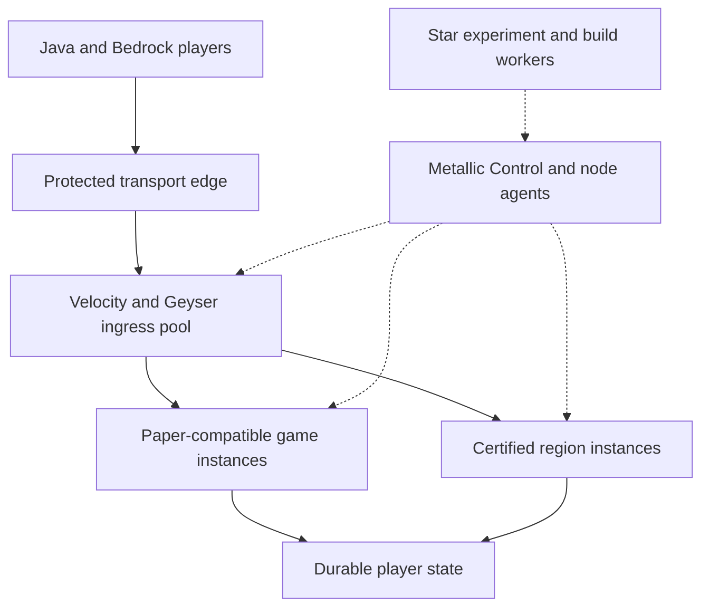

# Metallic MC: custom server and network performance research

Research date: 2026-10-19 UTC (2026-10-18 evening in America/Chicago).
Status: **architecture and experiment specification, not a deployed engine, working fleet manager, or measured performance result.**
Authoring actor: owner-directed ChatGPT, not autonomous Star AI.

## Decision and objective

Build a Paper-compatible Metallic server distribution with narrowly scoped, measurable patches; retain a separately tested region execution profile for compatible plugins. Extend the existing Go Metallic Control and Linux Agent with reliable instance lifecycle, placement, session ownership and recovery. Keep Velocity as the initial connection engine with Metallic extensions.

The performance objective is more useful gameplay at the same latency, correctness and resource budget. A claim such as "20% more active players at the rated SLO on this hardware and plugin set" can be tested. Global superiority across every server, hardware configuration, plugin and workload cannot be established by a benchmark of one game mode.

The proposals below build on the existing innovation notes. They describe experiments, not claims of original inventions or already demonstrated gains.

## 1. Actual repository and hardware baseline

At inspection, `main` commit `3dfe84a42b0aadb201eb241a5cd97a0394917df8` contained only [README.md](https://github.com/oncoursemail/metallic-mc/blob/3dfe84a42b0aadb201eb241a5cd97a0394917df8/README.md).

[Draft PR #1](https://github.com/oncoursemail/metallic-mc/pull/1) contains the Go dashboard, Linux metrics agent, advisory resource manager and opt-in Star status API. [Draft PR #11](https://github.com/oncoursemail/metallic-mc/pull/11) adds further interface and I/O-pressure planning work. Their descriptions distinguish prototypes from actual game hosting. Other design and moderation branches remain separate work in progress.

The existing [architecture](https://github.com/oncoursemail/metallic-mc/blob/feat/foundation-control-plane/docs/architecture.md), [benchmarks](https://github.com/oncoursemail/metallic-mc/blob/feat/foundation-control-plane/docs/benchmarks.md), and [innovation lab](https://github.com/oncoursemail/metallic-mc/blob/feat/control-surface-v2/docs/INNOVATION-LAB.md) already propose Paper/Folia profiles, a PSI governor, NUMA experiments and warm game pools. This note turns them into stronger execution contracts and acceptance criteria.

The [2026-10-18 hardware snapshot](https://github.com/oncoursemail/metallic-mc/blob/feat/foundation-control-plane/docs/hardware-snapshot.md) records an EPYC 7451 machine with 24 physical cores/48 threads and approximately 125 GiB visible RAM, plus an i7-9700 machine with 8 cores and approximately 15 GiB RAM. Both were sharing resources with Star workloads; the smaller machine already had Wings/Docker. The larger machine's system partition had limited free space. These are historical observations, not current utilization or capacity.

Storage media/IOPS, sustained clocks, WAN upload, geographic latency, loss/jitter, power resilience and currently allocatable resources remain unmeasured. A 10 Gb/s NIC does not establish a 10 Gb/s internet connection. Preserve existing Wings ownership rather than having another controller mutate its containers directly.

## 2. Define the product layers

| Layer | Initial foundation | Metallic's custom contribution |
| --- | --- | --- |
| Server simulation | Pinned Paper | Compatible optimized distribution, diagnostics, conformance and patch selection |
| Region simulation | Pinned Folia when appropriate | Certified plugins, locality experiments and workload-specific tuning |
| Connection gateway | Velocity | Admission, party reservations, compatibility routing and recovery |
| Bedrock bridge | Geyser/Floodgate | Verified transport bindings, identity and client tests |
| Fleet operations | Existing Go Control/Agent | Durable allocations, instance lifecycle, immutable templates and failure recovery |
| Development | Existing Star planner plus optional Codespaces | Bounded experiments, source evidence, repeatable verification and draft PRs |

Velocity is a Minecraft proxy, while Paper/Folia execute worlds. Compare gateway performance separately from simulation performance. [Velocity](https://docs.papermc.io/velocity/).

Paper currently documents Java 25 for 26.1+; current upstream [build properties](https://github.com/PaperMC/Paper/blob/main/gradle.properties) specify 26.3. Pin exact upstream commits and builds in the lab. [Paper requirements](https://docs.papermc.io/paper/getting-started/).

### Recommended network topology

Gameplay uses local routing state and direct backend connections. Controller or analytics failure should not interrupt already healthy sessions. New allocations require fresh valid reservations; unavailable control services may pause new allocation while existing games continue.

## 3. Paper compatibility is a tested contract

A plugin doing synchronous world reads, mutations and callbacks may depend on a single ordered execution context. Running the same calls on unrelated threads can change gameplay, violate ownership or corrupt state. A universal adapter cannot infer arbitrary plugin intent or make unsynchronized global plugin state safe without changing behavior or restoring serialization.

Folia has global, region, entity and async schedulers. Its supported declaration alone does not establish thread safety; entity work must follow the entity. These APIs also operate on Paper, making them a suitable target for new Metallic plugins. [Paper/Folia support](https://docs.papermc.io/paper/dev/folia-support/).

| Execution profile | Compatibility promise | Best initial workload |
| --- | --- | --- |
| Metallic compatibility | Pinned Paper API and certified plugin semantics | Survival, existing plugins, dense arenas |
| Metallic regions | Certified region-safe plugins and ownership contracts | Separated populations and independent areas |
| Optional purpose-built instance | Explicitly custom gameplay/API | A mode whose implementation needs little vanilla behavior |

The first profile is the primary route to the user's Paper-plugin requirement. Ship compatibility and region execution as distinct startup profiles or artifacts with explicit plugin certification; changing threading models is not a live toggle. The optional custom instance is outside that promise. Minestom explicitly does not run traditional Paper/Bukkit plugins and implements little vanilla gameplay; evaluate it only for separately built modes. [Minestom suitability](https://minestom.net/docs/when-to-use).

NMS/reflection plugins need exact-version tests beyond public API coverage because Minecraft internals are unstable. [Paper internals](https://docs.papermc.io/paper/dev/internals/).

A compatibility certificate must include engine/source revision, Java runtime, configuration hash, exact plugin JAR hashes, dependencies/load order, world/datapack/resource-pack fixtures, execution profile and passed/failed/skipped cases. "The plugin enabled" is only one check.

### Conformance suite to build

| Contract | Test scenarios | Promotion-blocking failures |
| --- | --- | --- |
| Loading/API | Same plugin binary on baseline and candidate; bootstrap, dependencies, services, commands | Missing API, linkage errors, load-order changes |
| Events | Priority, cancellation, nested events, mutation timing, thread context | Skipped/reordered contractual callbacks or wrong-owner access |
| Schedulers | Delay/repeat/cancel, entity movement/removal, teleport and shutdown | Duplicate/lost tasks, wrong-owner mutation or deadlock |
| Inventory/economy | Simultaneous interactions, stale requests, item components, logout/save | Duplicated/lost committed state |
| Mechanics | Redstone, pistons, hoppers, fluids, collisions, pathfinding, lighting | Undeclared behavioral divergence |
| Plugin combinations | Protection + economy + custom items + teleport + permissions | Failures that individual plugin tests miss |
| Persistence | Restart, interrupted save, crash during transfer, backup restore | Corrupt chunks, duplicate/missing entities, unusable recovery |
| Bounded hostile-input regression | Invalid state transitions, malformed data, disconnect bursts, excessive queued work | Crashes, bypasses or unbounded resource growth |

Compare defined invariants and distributions where simulation is nondeterministic. Keep performance optimizations separate from optional gameplay rules that reduce simulation distance, mob behavior, collision work or visual quality. Those settings may be useful, but do not establish faster execution of an equivalent workload.

## 4. Engine experiments worth pursuing

### E1. Make chunk work follow current player demand

Paper already has concurrent-load/generation limits, per-player rates and chunk worker/I/O settings. Start by profiling and tuning these existing mechanisms. [Global configuration](https://docs.papermc.io/paper/reference/global-configuration/).

Proposed extension: track demand age, urgency and continued usefulness. Reserve some admission capacity for an accepted join/teleport while maintaining fairness for exploration. Cancel an obsolete demand reference when its player disconnects or moves elsewhere; preserve shared dependencies and authoritative tickets that other consumers still need. Cancellation must recheck ownership and consumers without races, including neighboring generation dependencies and save work. Bound queued work by memory and I/O cost. Stop speculative prefetch admission under pressure.

Measure usable-world readiness, chunk latency tails, queue age, wasted work, heap and disk traffic during scripted joins, teleports and exploration. Use both pregenerated and fresh-world fixtures. Fail the patch on ticket leaks, starvation, missing required chunks, broken generation dependencies or data loss.

### E2. Reuse identical visual and replication work

Begin in Metallic-owned plugins: avoid recomputing unchanged scoreboard components, cosmetics and display state per viewer per tick. Send deltas when the actual state changes, respecting the selected visual update contract. A crowded lobby is a useful fixture.

Then consider a narrow engine serialization cache only if profiles show expensive identical work. Keys may need world/chunk revision, protocol, visibility, anti-xray result, item obfuscation, permissions and plugin personalization. Cache immutable payloads before connection-specific processing. Account for all content-changing plugins and compression/framing transformations in the cache boundary or key. Keep encryption, personalized state and incompatible protocol translations separate, and make buffer ownership and lifetime explicit.

Test hidden players, changing permissions, equipment, resource-pack rendering, block edits, spectators and mixed clients. Record serializer CPU, allocations, update latency, bytes sent and bounded cache memory. Reject any state leakage or stale visuals. Nearby players do not necessarily receive identical information.

### E3. Improve measured serial hotspots

Inspect repeated collision/spatial queries, object allocation or lookup work on the owning thread. Prefer one targeted algorithm/data-layout/cache change with explicit invalidation over a broad asynchronous rewrite. Preserve candidate completeness, callback order and plugin mutation effects.

Moonrise already optimizes many of these areas, and its README says effectively all of its changes are included in Paper. It also identifies C2ME as fundamentally incompatible with its chunk system. Treat those projects as research sources, not add-on performance layers that can all be installed into Paper. [Moonrise](https://github.com/Tuinity/Moonrise).

A focused microbenchmark can test the mechanism; actual sparse and dense game scenes must establish the benefit.

### E4. Snapshot, compute, validate, commit

For a proven expensive pure calculation:

1. Capture a bounded immutable snapshot on the current owner.
2. Compute on a worker without live mutable world objects.
3. Return a result tagged with source revisions and ownership context.
4. Revalidate on the current owner before applying it, including relevant entity movement, plugin state, random-number state and tick-sensitive decisions rather than only chunk revision.
5. Bound retries and discard/recompute or use the existing synchronous fallback if stale.

Measure snapshot cost, queue delay, useful completion rate, stale rejection and main-thread savings. Rapidly changing terrain may invalidate so much work that the patch loses. Required synchronous API results and arbitrary plugin callbacks cannot be silently deferred. Keep this behind an experimental flag.

### E5. NUMA locality without starving regions

Folia documents deadline-oriented scheduling that is not NUMA/core aware. It also requires adjacent interacting regions to merge and single-writer region ownership. [Folia overview](https://docs.papermc.io/folia/reference/overview/).

First compare ordinary placement, process CPU locality, and CPU plus memory locality for independent JVMs on the recorded EPYC topology after fresh verification. Only then investigate region affinity with bounded work stealing and deadline overrides. Preserve entity migration and merge/split correctness.

Measure per-region queue wait and tick tails, migrations, memory locality, frequency and fairness under quiet and competing-AI loads. Hard affinity can worsen balance. A dense fight remains a connected simulation hotspot; idle cores elsewhere do not make it independent.

### E6. Region-policy adaptation

After E1–E5, investigate whether measured region cost and population movement can improve split/recalculation policy with hysteresis. Upstream already has a regionizer and thresholds; this would refine policy. Do not split directly interacting state solely to manufacture parallelism. Track merge/split churn and time to safe parallel execution.

## 5. Custom network software that improves player experience

### N1. Atomic capacity and whole-party reservations

Determine eligibility before ranking a destination: current heartbeat, accepting state, matching game/protocol/plugin contract, tested capacity, resource headroom and no drain/deployment hold.

Then compare transparent routing scores using measured latency, predicted tick pressure, queued/reserved players, warm readiness, I/O pressure, party location and failure-domain concentration.

Reserve slots atomically before returning a route. Include request ID, party ID, server ID, count and expiry. Retries with the same request ID return the same reservation. A backend join claims the reservation; disconnect/failure releases or expires it. Reserve the whole party together.

This avoids two proxies simultaneously promising the same last five slots. Test the policy against round-robin and least-player-count under identical arrivals. Stale metrics remove a destination from new allocations; they do not prove the running game must be killed. Use cooldowns and hysteresis to avoid oscillation.

### N2. Durable player handoff with fencing

A lease is insufficient if an old server pauses and later resumes. Add a monotonically increasing ownership epoch and state version. Every authoritative mutation must be rejected unless its epoch/version still matches. Enforcement must happen at the storage boundary.

Proposed handoff:

1. Reserve a compatible destination.
2. Freeze relevant source mutations and flush registered state providers.
3. Persist the snapshot, transfer record and new owner epoch transactionally.
4. Connect using a short-lived opaque transfer ID resolved by the destination.
5. Activate the matching state once, idempotently.
6. Mark complete and release the old allocation.
7. On timeout, recover from the durable record with a new valid epoch where needed; never blindly resume both sides.

Use an outbox for replayable notifications and deduplicate by transfer ID/phase. Redis Pub/Sub has at-most-once delivery and must not be the only record of a transfer. PostgreSQL transactions provide useful concurrency mechanisms, with complete retries when serializable work conflicts. [Redis delivery](https://redis.io/docs/latest/develop/pubsub/); [PostgreSQL isolation](https://www.postgresql.org/docs/current/transaction-iso.html).

This guarantee applies to Metallic-owned state and certified plugin adapters. Publish prepare/flush/snapshot/restore/commit hooks. Arbitrary Paper plugins can write their own stores or on logout; the Paper API alone does not make them participate in a distributed transaction. Unsupported state remains local or uses its established cross-server implementation.

Test crashes, long pauses, partitions, duplicate messages, out-of-order phases and retries at every transition. Zero stale-owner writes, double activation or lost committed economy operations is the proposed fault-suite criterion. World simulation and uncheckpointed progress need their own stated recovery point.

### N3. Immutable match templates and verified readiness

A template manifest pins Minecraft, engine, plugin bundle, configuration, world and resource-pack hashes. Each instance receives its own writable world with exactly one owning process; multiple server processes must never open the same writable world. Use copy-on-write/reflink only if supported by the actual storage and shown to help; ordinary copies remain a valid backend.

Instance lifecycle: Prepared → Starting → Validating → Ready → Allocated → Draining → Stopped.

Readiness requires the expected build, plugins, required chunks and mode-specific game bridge. A process or open TCP port alone is insufficient.

For reset: stop admissions; finish/drain the match; flush durable state including registered plugin and external state providers; stop and verify process exit; recreate from the immutable template; validate again. This avoids plugin tasks, entities, scoreboards and memory leaking between matches. Persistent survival worlds follow a separate backup/checkpoint procedure.

Maintain a small measured ready buffer. Compare its RAM and idle-CPU cost with improved time to playable. Agones provides a reference for ready-buffer autoscaling; its scheduling docs distinguish packed elastic capacity from distributed fixed bare metal. Keep the Go controller's game policy if an Agones backend is adopted later. [Fleet autoscaler](https://agones.dev/site/docs/reference/fleetautoscaler/); [scheduling](https://agones.dev/site/docs/advanced/scheduling-and-autoscaling/).

### N4. Protect game latency from shared AI work

Use real tick tails, scheduler wait and Linux CPU/memory/I/O pressure. PSI quantifies time lost to resource contention and is available per system and, where configured, per cgroup. [Linux PSI](https://docs.kernel.org/accounting/psi.html).

Start with recommendations only. After controlled validation, defer new checkpointable learning/build jobs, reduce their admission rate, or ask registered workers to checkpoint. Deferral must use an application checkpoint or admission boundary; suspending a process does not release its memory, locks, GPU allocation or all outstanding I/O. Preserve bounded interactive Star inference. A Minecraft tick thread never waits for a language-model response; asynchronous NPC requests require deadlines and a deterministic fallback.

Compare cgroup resource weights and CPU/memory placement with explicit headroom. Aggressive CPU quotas can introduce throttling delays, and JVM heap is only part of process memory. Include native/direct buffers, thread stacks, file cache and other services. [cgroup v2](https://docs.kernel.org/admin-guide/cgroup-v2.html).

Coordinate reservations with the existing Star planner and the owner of existing containers. A read-only advisory dashboard is not resource enforcement, and two independent schedulers must not both allocate the same spare capacity.

### N5. Correct Java and Bedrock ingress

Run multiple ingress proxies when capacity/failure isolation warrants it. Velocity does not support Minecraft-proxy-behind-Minecraft-proxy chaining; use an appropriate transport edge ahead of the pool. A replacement proxy can admit reconnects but cannot inherit a failed proxy's existing TCP session automatically. [Server compatibility](https://docs.papermc.io/velocity/server-compatibility/).

Restrict backend reachability to trusted proxies. Modern forwarding adds authentication but is not a firewall replacement. [Velocity security](https://docs.papermc.io/velocity/security/).

Current Geyser setup uses NetherNet with TCP signaling/discovery and UDP gameplay on the configured Bedrock port; mixed NetherNet/RakNet needs an additional UDP port. For Velocity deployments, install Geyser at the proxy. Verify HTTPS signaling and the exact supported client matrix. [Geyser setup](https://geysermc.org/wiki/geyser/setup/).

Cloudflare Spectrum currently lists Java support and excludes Minecraft Bedrock, and a TCP Spectrum application cannot directly use an ordinary Cloudflare Tunnel origin. Select an edge only after testing the actual transport requirements. [Spectrum limitations](https://developers.cloudflare.com/spectrum/reference/limitations/).

No local firewall can stop an upstream access link from being saturated. Protected ingress, usable WAN upload, geographic routing and power/router/ISP failure domains remain separate constraints.

## 6. Evidence that earns a performance claim

Benchmark rated gameplay, not just idle connections. Pin the bot harness protocol first: Mineflayer currently documents support through Java 26.1 while this project targets 26.3. MCProtocolLib supports custom bots/clients, but its exact codec must also be verified. Real Java and Bedrock smoke tests remain required. [Mineflayer](https://github.com/PrismarineJS/mineflayer); [MCProtocolLib](https://github.com/GeyserMC/MCProtocolLib).

| Workload family | Hold fixed | Main observations |
| --- | --- | --- |
| Dense hub/combat | Viewer counts, cosmetics, entities, collision rules | Tick tails, broadcast CPU, allocations, visible latency |
| Separated survival | Population paths, terrain, region-safe plugin set | Per-region wait/tick tails, safe parallelism, fairness |
| Exploration/teleports | Paths, fresh vs pregenerated state, distances | Usable-world latency, disk demand, abandoned chunk work |
| Plugin/mechanics scene | Exact plugins and redstone/entity fixtures | Behavior, callback cost, item integrity |
| Join/transfer bursts | Arrival rate, party size, state mutations | Queue time, reservations, handoff correctness |
| Java/Bedrock mix | Client builds and actions | Translation overhead, identity, movement/items/pack behavior |
| AI contention | Model/job mix and resource allocations | Game latency, AI response time, PSI, throttling |
| Failure/reset/soak | Declared faults and duration | Recovery, state integrity, leaks and bounded queues |

Use at least five independent process runs after appropriate warmup for initial comparisons; alternate baseline/candidate order. Preserve world state and cold/warm cache conditions. Record CPU clocks, memory limits, JDK, kernel, engine/plugin hashes and background load. Do not treat correlated ticks as independent experimental repetitions. Five runs are an initial minimum, not a guarantee of precision; report variation and an inconclusive result when the evidence cannot distinguish the candidate from noise.

Collect tick execution AND scheduler wait, individual regions and worst hot regions, p50/p95/p99/max, ticks over 100 ms, application interaction latency, GC/allocation, storage wait, queue age, packet bytes, admission success and errors. A 20 ms tick after 80 ms in a queue is already late.

Paper recommends bundled spark profiling while the issue occurs. Focused JVM microbenchmarks and concurrency stress tools can test a mechanism, but actual game workloads establish server capacity. [Paper profiling](https://docs.papermc.io/paper/profiling/).

### Proposed initial gates, all unachieved

- Rated-load tick execution p95 ≤40 ms and p99 ≤50 ms, plus separately acceptable scheduler wait/interaction latency; no hiding a hot region in network averages.
- No detected corruption, stale-owner writes or duplication in the declared fault/conformance suite.
- No OOM, unbounded queues or growing post-GC live-memory trend during the defined soak.
- A predeclared practical improvement for the chosen target, initially 10% as a project hypothesis, with uncertainty reported.
- No material holdout regression; an initial 5% threshold is a project choice to calibrate against baseline noise.
- Exact feature/settings parity for an engine speed claim. Reduced work gets its own capacity-policy report.
- Successful backup/restore and canary rollback, including a stated recovery point if gameplay data changed.

Keep independent holdout workloads under evaluator control. Star may propose an optimization and tests, but cannot redefine a failing score as success.

## 7. Capacity arithmetic and hardware strategy

Rated capacity is bounded by simulation, RAM, storage, gateway CPU, WAN, database and recovery capacity. Many players across many instances is a different target from the same number in one interacting world.

Illustration, not a measurement: if outbound traffic averages 50,000 bytes/second/player, 1,000 players need 400 Mbps before additional uncounted overhead. If a 100 Mbps upload link is limited by policy to 70% sustained use, that assumption permits about 175 players on bandwidth alone. Measure actual bytes for each mode; resource packs and exploration can change demand sharply.

Do not assign a player limit from physical cores or RAM alone. Test representative 20/50/100-player pilots only as capacity permits, then increase the offered load until the SLO fails. Report the highest sustained passing load with confidence and duration.

Use the recorded EPYC for parallel independent instances, distributed survival experiments and background services where it benchmarks well. Compare the i7 for small latency-sensitive instances only after reserving resources for its existing workloads. Neither choice is a hardware superiority claim. More capacity eventually requires more suitable hardware/uplink; software cannot eliminate physical limits.

## 8. Implementation order and ownership

| Milestone | Deliverable | Dependency/exit test |
| --- | --- | --- |
| M1: baseline integration | Reviewed existing Control/Agent foundation and persistent telemetry | Existing drafts reviewed; no false live status |
| M2: reproducible lab | Release manifest, protocol probe, scripted fixture runner, conformance plugin | Same workload executes on pinned baseline; actual results persisted |
| M3: one private game instance | Bounded launch/readiness/drain/stop through a controller adapter | Ownership, process/resource limits, logs and recovery exercised |
| M4: game reservations | Atomic expiring whole-party allocation | Concurrent/retried requests never double-book capacity |
| M5: targeted fast path | E1 or E2 or E3 chosen by profile | Meaningful improvement and conformance pass |
| M6: persistent handoff | Fencing and supported state-provider adapters | Fault injection at every transfer phase |
| M7: measured warm pool | Immutable reset plus ready buffer | Faster time to playable with no state leakage |
| M8: coordinated resource governor | Star/Metallic reservations plus controlled deferral | Better game tails with acceptable interactive AI service |
| M9: region research | E4/E5/E6 behind flags | Benefits on actual hardware without ownership/fairness regressions |
| M10: protected public pilot | Tested ingress, backups, recovery and capacity | Actual WAN/client/edge evidence and approved deployment |

Use Codespaces for inexpensive code/build experiments and intended hardware for performance claims. Each Star proposal should include source evidence, bottleneck, expected mechanism, one primary metric, configuration diff, correctness risks, rollback and an exact run receipt. The controller should show observed stages such as queued, running, benchmark failed, draft PR and deployed; those states require corresponding evidence.

Maintain an upstream patch ledger with reason, baseline SHA, measurements, tests, license and removal conditions. Prefer changes that can be upstreamed or cleanly dropped as Paper evolves. Add new forks only when maintenance cost is justified by measured benefit.

## 9. Distribution and attribution

Paper's license describes its GPLv3-derived code and additional MIT availability for some contributions. Folia also has GPL patch licensing. Preserve the relevant upstream notices and distribution/source obligations; original Metallic services and branding do not make inherited engine code exclusively proprietary. [Paper license](https://github.com/PaperMC/Paper/blob/main/LICENSE.md); [Folia patches license](https://github.com/PaperMC/Folia/blob/ver/26.3.x/PATCHES-LICENSE).

Use the established upstream patch/bootstrap distribution approach and review Mojang's EULA before distributing engine binaries; Paperclip is the relevant upstream launcher project. [Minecraft EULA](https://www.minecraft.net/en-us/eula); [Paperclip](https://github.com/PaperMC/Paperclip).

This research created no running game server, new Paper/Folia fork, authentication grant, public edge, deployed resource controller or benchmark result. It provides the next reviewable engineering steps for building and proving those capabilities.
