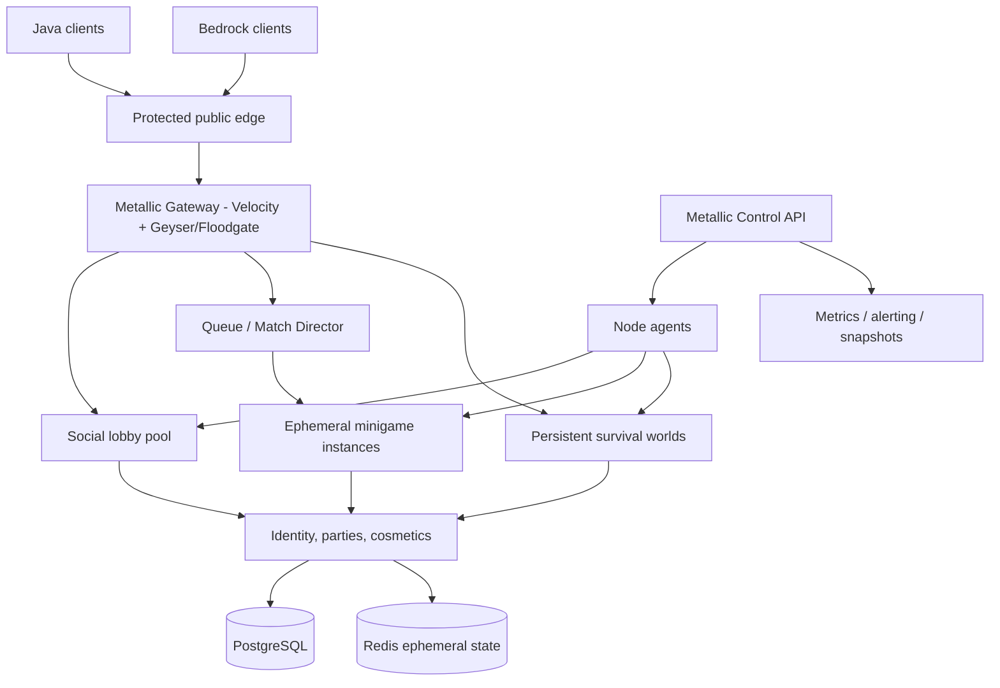

# Metallic network architecture / Architecture Decision Record 0001

Status: **proposed**, October 18, 2026. A topology blueprint is not proof of deployment.

## Design goals

A Java-first, Bedrock-accessible, privately operated fleet of game servers, with the control plane wholly owned by Metallic. Begin with a single local Linux machine, expand to multiple physical nodes, then protected edge locations if traffic justifies it. Keep game data safe, isolate crashes and exploits, and make adding a machine operationally predictable.

## Reference topology

There are **two planes**:

- **Data plane** handles active gameplay and session routing: protected edge, Velocity cluster, Geyser/Floodgate, Paper/Folia backends and purpose-built game instances. Player joins must continue even when an analytics dashboard is down, wherever safely possible.
- **Control plane** configures and observes physical nodes, inventories and lifecycle of instances, provision jobs, deployments, logging and audit. Fleet actions must be authorization-checked, bounded, recorded and reversible.

## Component placement

| Component | First network pilot | Scale phase | Principle |
|---|---|---|---|
| Protected edge | External mitigation provider | Multiple ingress locations | Do not put home/router IP in public game DNS |
| Java proxy | Velocity | Multiple stateless Velocity proxies | Modern forwarding + firewall and private network |
| Bedrock bridge | Geyser/Floodgate on ingress proxy | Multiple supported Bedrock ingress points | Verify both TCP and UDP NetherNet transport |
| Lobby | Paper with MetallicCore | Several lobby instances | Prefer lightweight/simplified gameplay |
| Competitive matches | Paper initially; Minestom where viable | Many short-lived dedicated match instances | Never share match execution across unsafe threads |
| Survival | Paper; Folia only after plugin audit | Partition/shard by gameplay | Folia regions are not interchangeable with server sharding |
| Durable identity and stats | PostgreSQL | Replicated/backed up database | DB is source of truth, not Redis |
| Match queues and transient state | Redis with namespaced keys | Redis HA where justified | Expect cache loss; make operations idempotent |
| Game binary/config distribution | Signed, pinned artifacts | Immutable release bundles | No runtime download of untrusted plugins |
| Fleet management | Metallic Control + Agent telemetry | Secure deploy/backup/orchestration agents | Don't grant nodes unlimited shell execution |
| Observability | Node HTTP heartbeats | Prometheus/OpenTelemetry + dashboards | Collect p95/p99 network, MSPT, memory, restarts |

## A game is not a server

A lobby, game match, survival world and proxy are different workloads. Record CPU allocation, per-instance memory cap, thread count, number of tick-active entities, average packet throughput, and GC data separately. Typical enterprise-scale designs serve thousands of players by distributing them among dozens to hundreds of game instances. **Never promise that one CPU/JVM can handle 10,000 players in a heavy vanilla world**.

## Compatibility policy

- **Tier A:** unmodified supported Paper plugins on compatibility-first backends.
- **Tier B:** custom Metallic plugins supporting Paper + Folia only after thread-safety testing using global, region, entity and async schedulers.
- **Tier C:** custom Metallic-native services or minigame engines (e.g., Minestom) that need no Bukkit plugin compatibility.
- **Tier D:** experimental fork of upstream engine, behind a feature flag and tested against the same version, workload, plugins and hardware as the upstream baseline.

A compatible Paper fork must pass plugin API tests, event semantics, data/save compatibility, recovery tests, and regression sweeps. Folia's region scheduler is not a magic performance switch; workloads clustered in one region may remain bottlenecked.

## Protocol versions (October 2026)

Paper's current developer documentation targets Minecraft 26.3 and Java 25 for 26.1+. Geyser documents support for Bedrock 26.30–26.52 and Java 26.3. Don't hard-code protocol versions into Metallic beyond negotiated capability checks. For older Java clients, evaluate ViaVersion after core network compatibility is stable. Console Bedrock discovery may need platform-specific joining flows; test on actual supported clients.

### Important Bedrock 2026 change

Current Geyser documentation describes **NetherNet** (TCP discovery + UDP gameplay) at the configured Bedrock port, with optional separate RakNet UDP for older supported clients. A Java-only TCP edge or UDP-only old guide is not enough. Source: https://geysermc.org/wiki/geyser/setup/ .

## Data ownership

Player ID keys must distinguish authenticated Java profiles and Bedrock/Floodgate identities without assuming equivalent UUIDs. Avoid changing UUID interpretation mid-launch. Cosmetics, currency, permissions and punishments must be network-global, replay-safe and auditable. Use durable writes for transactions; cache only read models or reconstructible state. Restore backups in a staging environment.

## Infrastructure options

Phase 1 uses Linux bare-metal nodes, services under systemd or isolated containers, and a local private subnet. Phase 2 can evaluate Nomad/Consul or a carefully configured Kubernetes deployment, but both add significant complexity and are not prerequisites for a small local network. Avoid designing a public hosting control plane until resource isolation, egress restrictions, abuse response and billing risks are addressed.

## Next architectural decisions

1. Record real hardware CPU model/clock, RAM, disks, NIC, uplink bandwidth, geographic latency and power redundancy.
2. Select an external protective edge supporting both current Java and Bedrock transports; test failover and origin privacy.
3. Stand up private Velocity + Paper pilot and verify forwarding/authentication.
4. Measure a realistic 20, 50, 100, 250 player-per-game workload before defining match sizes.
5. Define first custom game mode and ensure its world/entity/packet costs are measured independently.
