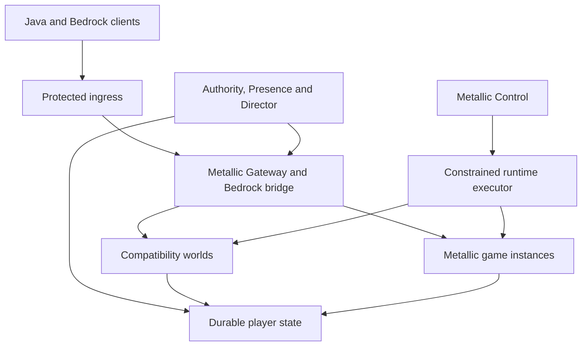

# Metallic-MC custom network architecture

Owner-directed engineering specification, **2026-10-20 UTC**.

**Decision:** build Metallic-owned gateway, authorization, presentation, session,
game-service and fleet software. Velocity, LuckPerms and TAB are comparison
baselines and migration interfaces. A complete replacement is the target; the
code delivered with this specification is an offline core, not a playable proxy
or a production permissions/display plugin. Performance superiority is unproven.

This supersedes the earlier assumption that Velocity extensions are the final
gateway architecture. It retains the working control foundation, project
isolation, explicit client compatibility and evidence requirements. The old UI
and three design alternatives remain available until the owner selects one.

## 1. What we intend to make better

The opportunity is a coordinated network whose components share explicit player
identity, ownership and policy versions. We want an operator to answer: why was a
player routed here; which rule authorized an action; which server can save this
inventory; why is a rank or vanished player visible; and what happens if the
owner process disappears halfway through a transfer?

That is an original integration design for Metallic, not a claim to have invented
versioned authorization, fencing, delta rendering or admission control. The
[research ledger](research.md) records the existing capabilities and primary
sources. The [experiment plan](benchmarks.md) defines how comparative claims must
be earned. An implementation with fewer features is not automatically faster at
equivalent work, and one game-mode benchmark cannot establish universal victory.

| Component | Metallic-owned responsibility | Baseline or maintained dependency |
| --- | --- | --- |
| **Metallic Gateway** | Java session engine, routing, aggregate budgets, authenticated handoff, fleet drain | Velocity and Gate as independent comparisons; maintained crypto/network libraries |
| **Metallic Authority** | Policy compilation, identities, roles, context schemas, revisions, explanations, audit | LuckPerms semantics/import comparison; PostgreSQL durability |
| **Metallic Presence** | Player list, nametags, rank display, scoreboard/boss-bar ownership, per-viewer visibility and deltas | TAB behavior/client fixtures; Adventure or equivalent literal component encoding |
| **Metallic Director** | Parties, atomic slot reservations, queues, matchmaking, warm capacity and placement | Agones/Nomad as orchestration references and possible later adapters |
| **Metallic Runtime** | Typed instance lifecycle, immutable templates, readiness, resource enforcement, world ownership | Approved OCI runtime and Linux cgroup v2; no custom container kernel |
| **Metallic Games** | Lobby, original game rules, social systems, inventory domains, progression and moderation adapters | Paper compatibility profile; Minestom evaluation for authored modes |
| **Metallic Recovery** | Consistent checkpoints, backup manifests, restoration and reconciled restart | PostgreSQL-supported backups and a tested encrypted backup backend |

These are module boundaries, not a demand for seven distributed services. Start
with the existing modular Go controller plus a small number of actual processes.

This is the target topology. These services are not all deployed or implemented.

## 2. The shared player contract

Every trusted operation and derived view needs an explicit identity and version:

| Field | Meaning |
| --- | --- |
| Tenant/project | Prevents cross-project authority and data mixing |
| Player identity | Authenticated namespace and stable ID; names are presentation |
| Authority epoch | Distinguishes histories, especially after restore or state loss |
| Session generation | Monotonic ownership number within that history |
| Instance incarnation | A unique running instance, not a reused name such as lobby-1 |
| Policy epoch, revision and digest | Identifies the entire immutable policy document |
| Context revision | Identifies trusted world, mode, party, moderation and visibility facts |
| Presentation revision | Orders one viewer connection's derived output |
| Schema and validity bounds | Enables explicit compatibility and bounded use |

Identity adapters validate Java or Bedrock identity before admitting this state.
Account linking is an explicit, audited relationship; it does not equate a Java
UUID with a Bedrock name. The launcher, Discord account and Minecraft account
have separate authentication roles. Client-supplied plugin messages, cookies,
hostnames, ranks and context fields never establish authority.

The target controller will compile a candidate policy, validate all referenced
data, and publish the entire immutable snapshot. Production readers will switch
one complete pointer, preserving a coherent role graph and rule set. The current
offline compiler already produces complete snapshots and decisions containing
their version, deciding rule, inheritance witness and next known semantic time
boundary. The offline presentation model carries its exact source versions and
rejects stale queued view plans. Authenticated publication and the live reader
replacement path remain implementation work.

**Identification is not freshness.** A matching digest proves which snapshot was
used, not that it remains authorized. The production publisher must enforce
monotonic revisions, authenticated transport, time bounds and the minimum
acceptable revision. The current core deliberately does not pretend these
distributed guarantees exist.

### Proposed freshness and outage contract

Use push invalidations to improve responsiveness and bounded leases to limit
staleness when notifications are lost. The initial ordinary-policy lease target
is at most five seconds, with a p99 connected propagation target below one
second. These are unmeasured design targets, not current service guarantees.

| Operation during authority/database loss | Intended behavior |
| --- | --- |
| Existing ordinary movement and local simulation | Continue on the healthy owner where gameplay semantics permit |
| New administrative commands, ownership changes, rewards and economy commits | Require current authoritative checks and a durable commit; otherwise reject or report pending |
| Permission-sensitive local actions | Use only a still-valid, properly scoped policy lease; stop those actions at expiry |
| Rank badges and private/vanish visibility | Clear privileged or uncertain output at expiry; do not indefinitely replay a visible cached result |
| Ordinary public statistics and cosmetics | May use an explicitly bounded stale display; mark unavailable when that bound expires |
| New match allocation or transfer | Require an atomic reservation/ownership transition; an unavailable controller does not invent capacity |
| Analytics/NPC generation | Degrade independently; never block a game tick or packet loop waiting for an AI service |

Mandatory context facts are validated by the trusted action/engine adapter before
evaluation. A missing world or moderation fact must not accidentally deactivate
a restrictive contextual rule while retaining a broad allow. The tiny v1 policy
language has exact matching; the production context schema and policy linting
must make required facts explicit.

## 3. Metallic Gateway

### A real session engine

The first playable gateway target supports one explicitly pinned Java protocol.
It must complete online authentication and encryption, negotiated compression,
handshake/login/configuration/play transitions, keepalive, modern forwarding to
an isolated Paper backend, ordinary movement, inventory and chat. Then it must
switch that authenticated client to a second backend. A status responder,
framing library or blind TCP relay does not satisfy this milestone.

Use Go for the initial core and gateway experiment because the existing control
code is Go and the implementation can share tested contracts. This is an
engineering/maintenance choice, not a speed result. Compare with Velocity and
Gate under the same workload. Keep protocol and crypto dependencies explicit;
do not implement custom cryptographic algorithms, TLS or database consensus.

Each connection has a single ordered owner of its protocol, compression, cipher
and backend state. Async expensive work returns to that owner with a generation
and deadline. Stale completions are discarded. Authentication has bounded
concurrency, cancellation, response size and queue age. Failure to authenticate
must never become an offline-mode success.

Packet compression changes at a defined boundary, in each direction. Preserve
that order even when work is offloaded. Passthrough is allowed only where source
and target protocol/state semantics are known compatible; an unknown packet in a
translation path is not safely handled by copying arbitrary bytes.

### The performance hypothesis: budgets across the whole gateway

Velocity already has native acceleration, packet-size checks and backpressure.
The [tuning documentation](https://docs.papermc.io/velocity/tuning/) and pinned
source entries in the [research ledger](research.md#2-gateway-existing-safeguards-and-specific-opportunities)
establish that baseline.
Our proposed improvement is an accountable budget across all connections, not
claiming these basic mechanisms are new. For example, one thousand 4 MiB queues
would total roughly 4 GiB before other memory; individually reasonable caps can
still exceed a process budget. This is arithmetic, not an observed Velocity
allocation or vulnerability.

Before allocating an input frame or inflated output, reserve its bytes against
the connection and gateway budgets. If temporary capacity is unavailable, pause
reading while retaining the parsed boundary; resuming must not interpret body
bytes as a fresh length header. A frame larger than the total budget is a
permanent rejection rather than an infinite wait. Release credit on successful
consumption, disconnect and every error path.

Separate scarce work classes: authenticated gameplay, fresh authentication,
status queries, speculative joins, and cosmetic output. Reserve useful capacity
for existing players. Bound queue bytes, item counts, age, decompression work and
task concurrency. Drop obsolete visual updates first; never silently drop an
authoritative inventory operation. Overload must produce controlled rejection,
not uncontrolled queue growth. The framing code added with this specification
accounts for owned frame buffers only; it does not yet enforce all these budgets.

### Handling a fleet of proxies

Support a registry of gateway cells, health/compatibility data, weighted new
admission, draining and bounded blast radius. Existing connections stay with
their socket-owning cell. Changing DNS or a load balancer does not move the
socket, cipher state or buffered protocol state into another process.

Backend switching within a living gateway can preserve its client connection.
Moving to a different gateway uses a supported client transfer/reconnect path and
the server-side ownership protocol. Java transfer/cookie facilities establish a
new connection; cookies are small, client-held and temporary. Use an opaque
single-use handoff reference bound to the verified player, target, epoch,
generation and expiry. Keep durable inventory and authorization server-side.
The upstream protocol behavior is documented in [Mojang's Java 1.20.5 release
notes](https://www.minecraft.net/en-us/article/minecraft-java-edition-1-20-5).

Existing Velocity or Gate cells can be adapter-managed during migration. This
does not mean arbitrary proxy chains are trusted. Routing destinations come from
the approved registry, never a raw client hostname. Default to a direct backend
route; an explicit proxy-to-proxy route needs identity forwarding, loop detection,
hop limits and a conformance test.

### Bedrock has two network paths

The protocol-maintainer guide distinguishes HTTP(S) signaling from WebRTC UDP
gameplay ([Mojang guide](https://mojang.github.io/bedrock-protocol-docs/guides/nether-net-onboarding-guide/)). Own the routing/admission policy and eventually an NXS-compatible
signaling service, while initially using a maintained Geyser translator and
WebRTC/DTLS/SCTP implementation. Replacing every translation and transport layer
simultaneously would remove the compatibility baseline before it is measured.

The signaling endpoint chooses the admitted bridge and returns its reachable
candidate. Subsequent gameplay travels to that endpoint, so moving HTTP traffic
alone does not move active Bedrock sessions. Validate identity assertions and
their binding to the connection; HTTPS is not a substitute for game identity.
Plan protected TCP and UDP ingress and actual client tests, including MTU,
mapping, advertised addresses and loss. A DNS purchase is not a protected edge.

**Concrete correction:** our pinned Geyser b1265 warns that loopback cannot form
the required gameplay candidate pair. The current pilot is now staging-only and
launch is rejected before Java executes. A separate Metallic-MC container with a
reachable private non-loopback interface is required before private crossplay
acceptance. The owner has accepted the Minecraft EULA; that decision is recorded
in the comparison runtime and is not the remaining launch blocker.
See the [exact pinned Geyser source](https://github.com/GeyserMC/Geyser/blob/02dbfaccb8be68c47c176c96c24bdbddb472b375/core/src/main/java/org/geysermc/geyser/network/bedrock/nethernet/NetherNetServer.java)
and [dated transport announcement](https://geysermc.org/blog/preparing-for-nethernet/).

## 4. Metallic Authority: beyond a permissions file

The desired system owns authorization across game commands, routing, moderation,
creator spaces, infrastructure operations and rendering. Start with one small,
explicit policy language instead of accumulating ambiguous precedence rules.

The implemented v1 core has bounded roles and subjects, acyclic static role
inheritance, contextual and temporary memberships, exact action/resource matches,
and contextual/temporary rules. A matching deny defeats all matching allows;
otherwise an allow is required. Direct assignment does not bypass an inherited
deny. Unknown subjects, malformed requests, invalid documents and mismatched
versions do not grant permissions. There is no operator bypass or wildcard
syntax in this version.

Times use half-open windows: an expiry applies exactly at that instant. The next
decision boundary includes future denials and memberships, not only the winning
allow's expiry. Canonical ordering and a content digest make equivalent input
orders comparable. Compiled data and returned explanation paths cannot be
mutated through caller aliases. Lookup performs no I/O.

Production development then adds a durable editor/API with role scope,
authentication, conflict detection, audit events, draft simulation, import/export
and signed publication. An operator should preview how a change affects an
actual player and compare before/after explanations. Destructive infrastructure
permissions remain separate from normal in-game moderation.

### LuckPerms migration and compatibility

LuckPerms already supplies contextual caches, inheritance, metadata and API
explanations ([cache API](https://javadoc.io/static/net.luckperms/api/5.5/net/luckperms/api/cacheddata/CachedDataManager.Container.html)). It also has semantics that v1 deliberately does not implement.
Migration needs a lossless export inventory, a report of unsupported constructs,
and a differential corpus of real authorization queries. Do not translate
wildcards, node priorities or context/traversal behavior by guessing.

Run a shadow evaluator first: record which query differs and why, without
enforcing two independent policies. A published allow/deny change is an explicit
policy decision. Keep one authoritative writer and one enforcement route per
realm. Separate temporary migration bridges from the claim that Metallic is
drop-in compatible with the entire LuckPerms API.

## 5. Metallic Presence: one owner of the visible player

TAB already supports extensive per-viewer output, global lists and placeholders.
Its [placeholder](https://github.com/NEZNAMY/TAB/wiki/Placeholders) and
[global player-list](https://github.com/NEZNAMY/TAB/wiki/Feature-guide:-Global-playerlist)
documentation define useful baseline behavior.
The target improvement is common authority and controlled output work across all
these surfaces. A rank change, route restriction and display change should refer
to the same player/policy history, with bounded propagation and inspectable
reasons when a component is behind.

Build a dependency graph from authoritative events to derived facts and viewer
outputs. Recompute affected facts on changes, group identical outputs where
safe, compare against each viewer's last committed model, and emit only useful
changes. Cache keys include every fact that can alter visibility or content:
viewer, target, world/mode, relationship, policy/context revision, protocol,
resource pack and locale. Incorrect sharing can leak hidden players or staff
data. Never share a serialized buffer solely because two players are nearby.

Each client channel has an explicit owner. Scoreboard teams couple sort order,
name decoration, color, collision and visibility; multiple competing writers
cannot independently own these properties. The adapter must arbitrate or yield
the complete channel, and resynchronize on server switch. Privacy removals take
priority over decorative updates. No stale queued update may resurrect a row
after a newer removal.
See TAB's [team/nametag constraints](https://github.com/NEZNAMY/TAB/wiki/Feature-guide:-Nametags).

Client capabilities remain real limits. A custom server cannot make an
unmodified sidebar show arbitrarily many lines or create a Java-only visual
effect on an unsupported Bedrock client. Define Java and Bedrock layouts,
fallbacks, update frequencies, texture/font budgets, reduced-motion settings and
localization. Optional launcher/resource-pack enhancements must not prevent a
normal supported client from joining the core experience.

The implemented first slice covers policy-filtered player lists, deterministic
ordering, immutable versions and bounded remove/upsert plans. It rejects stale
history, wrong-session plans, and plans past a known policy time boundary. It
does not send Minecraft packets, implement a complete placeholder language, or
make multiple client packets atomic. Rank/context facts still come from a
trusted caller; the durable publication and connection writer remain work.

## 6. Session handoff and durable game state

The authority invariant is **at most one current writer**, with an intentional
unowned interval during transfer. The freeze point must invalidate the old
owner before the destination can become authoritative.

| Phase | Current writer | What must be true |
| --- | --- | --- |
| Active A, generation g | A | Authenticated session and current fence |
| Reserved A to B | A | Destination capacity reserved; bounded token and deadline |
| Frozen, generation g+1 | None | Source mutations quiesced; checkpoint reference durably committed; old fence rejected |
| Claimed by B, generation g+1 | B | Correct target, token, expiry, schema and checkpoint |
| Frozen transfer canceled/expired | None | Recovery can mint g+2; g is never reactivated |

The in-memory state machine now makes those transitions executable and rejects
stale, duplicated, expired and conflicting operations. It retains bounded
generation and transfer-ID history rather than forgetting an ID and reusing old
authority. A fresh machine requires a unique authority epoch. Caller-supplied
checkpoint digests are opaque evidence, not proof that a world was saved.

For production, serialize and durably commit these transitions using PostgreSQL
transactions with complete conflict retries. Couple the checkpoint pointer,
ownership transition, transfer record and outbox record in the same commit.
Consumers handle duplicated/reordered notifications idempotently. An RPC timeout
means the result is unknown until reconciled; it does not automatically cancel a
possibly committed operation.
PostgreSQL's [transaction-isolation documentation](https://www.postgresql.org/docs/current/transaction-iso.html)
defines the retry obligations; this is a proposed application design on top of it.

Currency/rewards use an append-only ledger with scoped operation IDs and payload
digests. Retry the same logical operation against its stored result; reject the
same ID with different content. Every authoritative storage mutation checks the
current epoch/generation. Define the idempotency retention horizon and recovery
behavior explicitly rather than claiming unbounded exactly-once execution.

Inventory has explicit domains: realm-local survival inventory, match loadout,
network cosmetics and transactional account balances. Shared survival inventory
requires a participating save adapter; arbitrary third-party plugins can keep
their own files/databases and do not become transactional because the proxy
switched servers. Unsupported providers must remain local or block handoff.

**World-file fencing is separate.** Rejecting old SQL writes does not stop a
paused Paper JVM from resuming and writing an open world directory. Stateful
world failover must remain disabled until the runtime/storage layer proves the
old writer cannot continue. One writable world belongs to one verified process
incarnation; starting a second copy from a stale heartbeat is forbidden.

## 7. Games, simulation and creator software

Maintain two explicit profiles. Compatibility worlds use pinned Paper and a
tested public API/plugin contract. Metallic-authored lobbies and minigames can
use a smaller custom game runtime, with Minestom as a concrete candidate library.
Its missing vanilla behavior and Bukkit API are real engineering work, not free
performance ([Minestom's own project description](https://github.com/Minestom/Minestom)). Current source versions also need a verified protocol bridge.

Folia is a workload-specific candidate for independently active regions. A
crowded connected fight does not become parallel because other cores are idle.
New game modules should respect entity/region ownership APIs so they can be
evaluated on both Paper and supported region profiles. Arbitrary plugin state
cannot safely be made concurrent by changing a thread pool setting.
See the [Folia region model](https://docs.papermc.io/folia/reference/overview/) and
[Paper's scheduler guidance](https://docs.papermc.io/paper/dev/folia-support/).

Optimize from traces: chunk demand cancellation and fair join reservations;
bounded identical-output reuse; measured serial hotspots; snapshot/compute/check/
commit for truly independent calculations; then locality experiments on the
actual NUMA topology. Preserve mechanics, anti-xray, plugin callbacks, data
formats and visibility boundaries. A smaller simulation distance is a gameplay
tradeoff, not proof of equivalent-work engine acceleration.

Own parties, chat/social state, matchmaking, instance templates, progression,
moderation/appeals and an original game mode. Server-authoritative validation and
replay evidence should precede anti-cheat claims; client and input differences
matter. AI-assisted NPCs and creator jobs run with quotas outside ticks and
cannot grant themselves operator access. Untrusted customer plugins need a later
tenant threat model, stronger isolation and artifact policy; a permissions
plugin is not a sandbox for arbitrary JVM code.

## 8. Custom infrastructure on the available machines

Begin with one dedicated Metallic-MC project boundary, one controller/authority
writer, one database, gateway/bridge, and a hub plus game instance. Metallic's
other project remains separately contained. Old Servers/Wings on Brain 2 remain
untouched. The existing account on Brain 1 currently has neither container tools
nor noninteractive administrator access, and Java is not installed on its PATH.
Those are actual provisioning blockers, not an EULA question.

The runtime executor accepts typed desired-state jobs naming approved images,
paths, instance IDs, resource budgets and deadlines. It does not expose arbitrary
shell, mount paths, external image URLs or a Docker socket to game code. Reconcile
observed process/container incarnations against durable reservations after a
controller restart. A missing reply does not imply the process never started.

Admission checks both host reserve and effective ancestor cgroup limits. CPU
bandwidth, memory high/max, I/O ceilings, disk/inodes, startup peaks and existing
reservations are distinct inputs. A Java heap cap is not total process memory;
weights are not guaranteed reservations. Unknown or stale pressure data does not
mean spare capacity. Protect active players by limiting simultaneous bootstrap,
world generation, backups, restores and build jobs.
The relevant platform interfaces are [cgroup v2](https://docs.kernel.org/admin-guide/cgroup-v2.html)
and [Linux PSI](https://docs.kernel.org/accounting/psi.html).

Placement first filters for fresh, compatible, ready, non-draining instances;
then ranks by measured latency, reserved capacity, tick/pressure headroom and
party locality. Reserve the whole party atomically before returning a route.
Start with zero or one extra warm worker if actual headroom permits. Queue new
work when the budget is exhausted. Persistent worlds do not scale to zero like
disposable matches.

Do not create a two-host control quorum and advertise high availability. Nomad's
own [consensus documentation](https://developer.hashicorp.com/nomad/docs/architecture/cluster/consensus)
explains why two voters cannot tolerate one failure.
Later clustered control requires independent failure domains and a measured
recovery/fencing plan. Agones or Nomad can become executor adapters when scale
justifies them; Metallic retains its game policy rather than rebuilding their
consensus algorithms.

## 9. Recovery, rollout and proof

For the first combined backup, quiesce durable gameplay operations, drain or stop
the owned world writers, complete registered state providers, take the database
backup through its supported mechanism, and record one manifest tying world
hashes to database checkpoint/LSN, schema, artifacts and authority history. A
newer economy database combined with an unrelated older world is not a coherent
restore. Keep encrypted independent copies and scoped deletion rights when the
actual destination is provisioned.

Restore into a new isolated target with a fresh authority epoch and a controlled
credential plan. Run the actual engines and database, inspect known world
markers and ledger totals, and perform a real client login. Checksums and backup
verification utilities cannot replace that exercise. The existing stopped
archive implementation is useful, but does not yet supply off-host encryption,
immutable retention, continuous database archiving or live-world checkpoints.
PostgreSQL separately documents [continuous archiving](https://www.postgresql.org/docs/current/continuous-archiving.html)
and the [limits of backup verification](https://www.postgresql.org/docs/current/app-pgverifybackup.html).

Rollouts use immutable artifacts, schema compatibility checks, canary sessions,
draining and a retained binary release. Rollback must preserve current
revocations and durable state; loading an old policy snapshot can regrant an
authority that was intentionally removed. Disable one owning feature at a time
with a deliberate fallback, not two simultaneous packet or state writers.

## 10. Delivery order and release gates

| Stage | Concrete deliverable | Evidence required before promotion |
| --- | --- | --- |
| C0 | Custom offline policy/session/presentation/framing core and specification | Unit, race, malformed-input and invariant tests; explicit limitations |
| C1 | Durable authority transaction and authenticated publication; private container runtime | Restart/retry/revocation tests, real resource enforcement, executor ownership |
| C2 | Own single-version playable Java Gateway and a backend adapter | Real online client, movement/inventory/chat, secure forwarding, backend switch |
| C3 | Authority and Presence adapters with one writer per channel | Shadow comparison, import mismatch report, two-client/per-viewer tests, timed revocation |
| C4 | Private Bedrock path and original game mode | Actual supported Bedrock client, UDP gameplay, authenticated cross-backend movement, device matrix |
| C5 | Fleet, parties, warm placement, checkpoint recovery and canary rollout | Crash/partition/full-disk/retry tests, no stale writes, restore drill |
| C6 | Comparative performance release | Matched traces, repeated runs and explicit supported workloads; no compatibility regression |
| C7 | Broader engine work and later hosting product | Demonstrated bottleneck, certified plugin/runtime contract, separate tenant isolation and operations |

The completion criterion is a usable, measured network with explicit guarantees,
not the number of custom binaries. Each stage replaces a real responsibility and
keeps a working comparison route until the replacement proves its contract.
