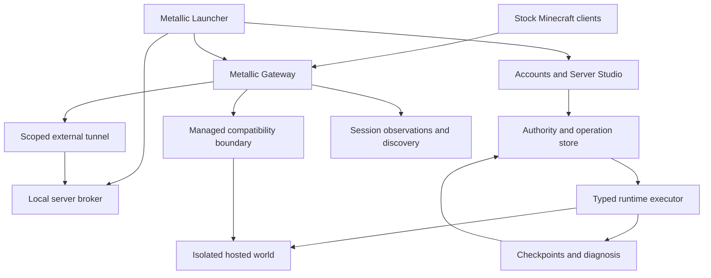

# Metallic launcher and server platform

**Decision date: 2026-10-20. Status: researched design plus implemented private foundation.**

Metallic is a desktop Minecraft launcher, a local server manager, a managed
hosting platform, and a game network. The existing original Gateway, Authority,
Presence, Director, Runtime, Games and Recovery direction remains the network
architecture; this document defines the product and tenant boundaries around it.
See [the network design](../custom-network/architecture.md) and
[this milestone's implementation](implementation.md).

The competitive objective is measurable improvement in the complete journey:
launch, create, understand compatibility, move a world deliberately, recover
reliably, and discover games with trustworthy evidence. A new name or a larger
feature list cannot establish superiority over production software.

This milestone adds original lifecycle, sync-inventory, population-observation
and diagnostic code; a local `metallic-doctor` executable; and authenticated
private Server Studio tools. It does **not** implement Microsoft/Minecraft
sign-in, launch a game client, run tenant containers, transfer files, serve
console/file sessions, publish community listings, or deploy a proxy. The
private controller remains disabled by default for Architect features. There is
no production isolation or player-capacity claim.

## 1. Product model: location, management and visibility

These are separate properties in the data model. The user interface presents
four understandable combinations:

| Mode | Where the game runs | Metallic control | Rules and discoverability |
| --- | --- | --- | --- |
| Local private | Owner's computer | Local launcher capabilities only | No platform registration, compulsory compatibility layer, directory entry or cloud telemetry |
| Hosted private | Metallic-managed infrastructure | Isolated runtime, managed distribution, quotas, private admission | Hosted-use rules apply; hidden from public discovery; explicit invitations |
| Hosted public | Metallic-managed infrastructure | All hosted controls, gateway admission and reviewed listing | Hosted and public-network rules apply |
| Local public tunnel | Owner's computer or another host | Metallic controls its gateway route and listing | Public-network rules apply; local process/storage remain externally controlled |

Private means a defined audience, not exemption from the rules for using hosted
compute. Local private stays independent. Closing the launcher or disconnecting
from Metallic must not prevent someone from managing their own disconnected
server. Future software must not silently reinstall agents or plugins on those
local private instances.

Sync creates or updates a **separate hosted copy**. It does not establish that
uploaded code became safe, nor grant Metallic hidden control of the original
machine. Offer two clear workflows: **Copy to hosting**, which creates a distinct
world branch, and **Move play to hosting**, which performs a controlled handoff
for the platform's active copy. An owner can still alter an independent local
copy; it cannot silently overwrite the active hosted generation.

Public tunnels remain a separately qualified future tier. A remote operator can
change their JVM or remove a plugin. Metallic can revoke its route/listing and
enforce its own gateway protocol, identity, population and resource-pack rules.
It cannot truthfully certify that operator's internal runtime as Metallic-hosted
isolation. If a public feature requires trusted in-process behavior, restrict it
to a suitable managed profile or disable that feature for external servers.

## 2. Research baseline and differentiation

Current primary product documentation already establishes much of the desired
baseline. [Minehut](https://www.minehut.com/) shows official experiences before
community discovery and documents browser files/plugins and sleep/wake behavior.
[MineKeep hibernation](https://docs.minekeep.net/hibernation) includes authorized
wake for whitelisted servers. [MineKeep externals](https://docs.minekeep.net/external-servers)
connect servers hosted elsewhere without importing their worlds. These features
are parity requirements for Metallic.

The original advantages to pursue are specific:

1. One transparent local-to-hosted transaction, with a diff, exclusions,
   compatibility result, recoverable destination and explicit conflict behavior.
2. Every public population figure has a documented source and freshness. Missing
   data stays unavailable; tenant-advertised numbers cannot create popularity.
3. A version profile explains exactly which client/edition combinations were
   tested and which features degrade, before the player joins.
4. Recovery is a demonstrated capability: periodically restore a checkpoint into
   an isolated candidate and record whether a real gameplay probe succeeds.
5. Diagnosis explains evidence, uncertainty and one reversible next experiment.
   It does not automatically delete a plugin named in an exception.
6. Hosting and first-party games use separate budgets and workload pools so a
   creator's runaway server cannot consume the resources reserved for a match.

The three detailed research appendices are [launcher and compatibility](research-launcher.md),
[tenant isolation](research-isolation.md), and [product/discovery/diagnostics](research-product.md).
They distinguish observed upstream behavior, design choices and unverified
integration gates. Moving documentation is dated research, not a version pin.

## 3. System boundaries

The drawing is the target architecture. The current controller is a single
private administrator service, not the production multi-tenant account system.
The implemented planners are in-process packages; diagrams must not be read as
evidence that the services or network paths are deployed.

Metallic owns the product model, orchestration, permissions, player-state
coordination, discovery evidence, diagnosis and game behavior. Mature operating
system isolation, databases, cryptography and protocol-translation components
remain deliberate dependencies. The custom Go gateway cannot load a Java
ViaVersion plugin directly. The
[ViaVersion platform guide](https://github.com/ViaVersion/ViaVersion/wiki/Creating-a-new-ViaVersion-platform)
describes its Java/Netty integration. Use a controlled Java compatibility boundary
while developing the custom protocol path, with separate licensing review and
conformance tests before changing that boundary.

## 4. Desktop launcher

The proposed desktop application has five primary areas: Play, Community, Your
Servers, Library and Account. Play begins with Metallic Games, followed by
friends/recently played and then community discovery. Your Servers consistently
shows the location, audience, current version profile, desired operation and
observed process state. A local icon and a hosted icon must never be ambiguous.

The launcher is optional for ordinary supported Minecraft connections. It adds
installation, profiles, resource-pack previews, joining, local management and
sync. It does not become a condition for stock-client access to compatible core
games. Within the shared Metallic launcher, MC remains a selectable component
alongside the existing RC/RB direction; installing MC must not install unrelated
engines or games.

Use a Metallic-owned public-client identity and system-browser Microsoft sign-in
with PKCE, supported authentication libraries and OS credential storage.
[Microsoft's documentation](https://learn.microsoft.com/en-us/entra/identity-platform/v2-oauth2-auth-code-flow)
supports the desktop authorization-code flow. A successful Microsoft login is
not the complete Minecraft identity integration: Prism's
[AuthFlow source](https://github.com/PrismLauncher/PrismLauncher/blob/develop/launcher/minecraft/auth/AuthFlow.cpp)
separates Microsoft, Xbox, Minecraft Services, entitlement and profile stages.
Do not reuse another launcher's application ID or ship a shared client secret.
Actual approved access for Metallic's application and an entitled test account
are release gates; this research did not establish a universal self-service
Minecraft Services approval process.

Resolve an immutable per-profile installation plan: game version, loader/modpack,
main class, JVM/game arguments, OS/architecture-specific libraries and natives,
asset index, required Java runtime, artifact origin, size and checksums. Download
to bounded staging, validate before promotion, and keep the previous working
profile. Never allow a server listing or remote HTML to supply a shell command,
executable path, environment variables or unbounded native bridge call. Use a
small typed local broker and an explicit IPC capability for the selected action.

Minecraft 26.1 requires Java 25 and changed world storage, according to its
[official release notes](https://www.minecraft.net/en-us/article/minecraft-java-edition-26-1).
Choose client and server Java independently from their resolved profiles. An old
client does not require downgrading the hosted server JVM. Bedrock is a separate
platform application; open a legitimately installed supported application where
the OS allows it, rather than promising a portable Bedrock binary for every OS.

Sign Metallic release metadata and updates with separated roles, expiration,
rollback protections and recovery procedures. The
[TUF specification](https://theupdateframework.github.io/specification/latest/)
is the reference model. Hashes alone establish correspondence to a manifest,
not publisher identity or safe behavior. Protect tokens from launch logs,
diagnostic bundles, synced files and remotely displayed account pages.

## 5. Compatibility that survives ordinary deletion

The user-facing requirement is mandatory compatibility on managed servers. The
enforcement mechanism is a protected platform distribution and admission checks.

| Desired relationship | Upstream components | Metallic support policy |
| --- | --- | --- |
| Newer Java client to older server | ViaVersion | Exact tested versions, not a universal promise |
| Older Java client to newer server, down to 1.9 | ViaVersion plus ViaBackwards | Feature-aware translated tier |
| Java 1.7/1.8 client to newer server | ViaVersion, ViaBackwards and ViaRewind | Separate limited legacy tier if qualified |
| Bedrock to Java | Geyser and appropriate Java compatibility | Independent edition/transport/pack matrix |
| Arbitrary modded combinations | No general guarantee | Exact loader/modpack profile or unsupported |

This direction is documented by [ViaVersion](https://github.com/ViaVersion/ViaVersion),
[ViaBackwards](https://github.com/ViaVersion/ViaBackwards) and
[ViaRewind](https://github.com/ViaVersion/ViaRewind). ViaBackwards documents
world-height, inventory and other old-client limits. Login success is insufficient:
test movement, combat, inventory, signs, books, chat, custom items, packs, transfer,
disconnect and anti-cheat behavior. Native/recommended, translated/tested and
legacy/limited badges should be visible in discovery.

Choose one translation boundary per route. Upstream
[installation guidance](https://github.com/ViaVersion/ViaVersion/wiki/Installation)
warns against installing it at both proxy and backend and explains placement
tradeoffs. A trusted first-party Paper profile can use backend translation for
state accuracy. Arbitrary tenant plugins require security-sensitive controls
outside their JVM; a managed compatibility gateway provides that boundary, with
its own gameplay/anti-cheat qualification. Do not equate these profiles.

Managed artifacts are pinned by reviewed version and digest, mounted read-only
outside the writable tenant volume, and shown as managed components in the file
manager. An attempted file-manager delete returns an explicit protected-component
error. If an approved distribution is damaged, block admission and rebuild from
the approved artifact. Do not run an endless downloader for an unpinned latest
JAR. The protected distribution is reconciled only for enrolled managed instances.

Untrusted Java plugins can invoke APIs to disable other plugins, and the JVM is
not a tenant isolation boundary; see Paper's
[PluginManager API](https://jd.papermc.io/paper/1.21.11/org/bukkit/plugin/PluginManager.html)
and [Java's Security Manager removal](https://openjdk.org/jeps/486).
Therefore presence of a mandatory JAR is not proof of runtime enforcement.
Host-owned evidence, edge enforcement and actual behavior probes must establish
admission. A malicious backend can still misbehave toward its players; compatibility
does not replace client safety, moderation or protocol limits.

## 6. Sync as a checkpoint transaction

The proposed transaction is:

1. Select the destination and whether this is a copy or active-play handoff.
2. Show the exact hosted profile, rule revision, resource budget and exclusions.
3. Stop the source writer or produce a specifically supported coherent checkpoint.
4. Inventory complete world roots with exact sizes and content hashes.
5. Stage bounded uploads into quarantine; verify actual bytes and archive contents.
6. Compare the destination's base revision/generation and retain its recovery point.
7. Restore into an isolated candidate, generate new hosted credentials and verify it.
8. Fence the previous hosted writer, atomically promote a new generation, then admit.

Failure before promotion retains the previous authoritative copy. A retried
request uses an idempotency key and the same immutable input digest. If local and
hosted copies both changed, offer a new branch or explicit restore; do not merge
region files or silently choose the most recent timestamp.

Version 26.1 moved dimensions, player data, namespaced storage and embedded packs.
Preserve full recognized world trees, not a historical hand-picked list of files.
The current planner supports only `world`, `world_nether` and `world_the_end`
roots with declared pre-26 or 26 layouts. Custom world names, loaders and plugin
databases need additional reviewed profiles. A declared layout is not proof that
uploaded bytes follow it.

World import, plugin import and configuration migration are separate operations.
Generate server.properties, forwarding secrets and runtime configuration from
platform policy. Never copy launcher tokens, private keys, stale agents, machine
paths or another host's credentials. Known-name exclusion cannot discover a
secret hidden under a harmless filename. Data packs, resource ZIPs and plugin
data can also contain active or malformed content and remain untrusted.

The implemented inventory planner validates metadata and gives a canonical review
digest. It reads no files, verifies no bytes, accepts no archives, uploads nothing
and always returns `executable:false`. The current HTTP preview is specifically
a first import at generation zero; it cannot update an existing hosted world.

## 7. Tenant isolation and network containment

Treat arbitrary JARs, native libraries and plugins as arbitrary code. The
[Kubernetes multi-tenancy guidance](https://kubernetes.io/docs/concepts/security/multi-tenancy/)
describes the stronger isolation required for hostile workloads. The target for
arbitrary-code hosting is a separately sandboxed server, preferably a microVM
where the host supports and qualifies it. A gVisor profile is a candidate earlier
implementation, subject to real Java/native-library/I/O tests. Neither choice is
an automatic guarantee or a measured performance advantage.

| Boundary | Required behavior |
| --- | --- |
| Project boundary | Metallic-MC and the separate Metallic project have separate project containers; legacy Wings/Old Servers remain outside this rollout |
| Tenant process | Non-root identity, no privilege escalation, dropped capabilities, maintained seccomp/LSM, separate namespaces or guest kernel |
| Storage | Only server-specific data and bounded temporary storage; no host paths, runtime socket, sibling volume or account credential store |
| Resources | CPU, total memory, process/thread, I/O, disk bytes/inodes, bandwidth, connections and logs are bounded |
| Ingress | Authenticated Metallic edge to a registered game endpoint; no public raw backend/RCON/control API |
| Egress | Default deny; explicit per-plugin destinations through a constrained broker; deny host, peers, metadata and management networks in IPv4/IPv6 |
| Administration | Typed operations scoped to principal, server and generation; no arbitrary shell, Docker flags or requested host PIDs |
| Suspension | Revoke admission and live flows, isolate/stop managed workload, preserve evidence and prevent owner restart bypass |

[gVisor](https://gvisor.dev/docs/architecture_guide/security/) explicitly relies
on external resource/network mechanisms, and the
[Firecracker production guide](https://github.com/firecracker-microvm/firecracker/blob/main/docs/prod-host-setup.md)
requires host networking controls. A sandbox can still contact a vulnerable
reachable management API unless network and application authorization prevent it.
Check DNS resolution and redirects in approved egress; never turn a URL field
into an unrestricted fetch proxy. Package fetching belongs outside the tenant JVM.

The host agent is privileged trusted software and must expose only bounded
server operations. Separate agent identity from telemetry, gateway forwarding,
player authentication and cloud accounts. Compromise of one server must not
provide credentials for the other planes. No silent fallback to weaker isolation
is permitted when a required sandbox cannot start.

Ordinary loopback binding is not sufficient between untrusted workloads on one
shared host. The [Velocity security guide](https://docs.papermc.io/velocity/security/)
requires protected backend reachability in addition to forwarding authentication.
Volumetric denial-of-service protection also needs upstream capacity; a local
packet filter cannot recover a saturated residential uplink.

## 8. Operations, console, files and recovery

| Operation | Required semantics |
| --- | --- |
| Start | Validate policy/profile and budget; boot with ingress closed; observe readiness |
| Admit | Separately validate running generation, compatibility, gateway and runtime proofs; require public review before listing |
| Stop | Revoke admission, save/shut down, verify writer exit; suppress automatic wake |
| Hibernate | Drain, stop, verify writer exit, verify durable checkpoint, release compute; authorized join may later wake |
| Restart | Fence/stop previous writer, preserve recovery, start new generation and complete admission |
| Suspend | Immediate route/listing/grant revocation, then containment; record reason/evidence; reject owner bypass |
| Reinstate | Clear the platform sanction through authorized review; keep route closed until fresh admission |
| Delete | Durable tombstone, revoke, stop/fence, quarantine; irreversible purge is a separate elevated retention action |
| Export/restore | Scoped checkpoint operation; restore creates a fresh epoch/generation and requires verification |

The lifecycle planner implements decision/order logic for the listed actions
except restore, which remains a future integration. It is not an executor or
durable state machine. Hosted Start from Failed explicitly stops and
verifies the previous writer before a replacement; failed health does not prove
process exit. Moderator scope covers suspension/reinstatement, while account
access, exports and deletion require their own authorized role. A local public
tunnel can be delisted/disconnected without deleting the owner's local world.

Persist desired and observed states separately. Proposed operation records bind
tenant, server, actor, action, request ID, policy revision, expected server revision,
runtime generation, input digest, attempts, step receipts and final outcome.
Use transactions/CAS for revisions and idempotency. Physical storage fencing
must actually stop an old writer; a number in a database cannot stop an isolated
process from writing its existing disk.

Console means Minecraft stdin and a bounded output stream, never a host shell.
Use scoped, expiring credentials, origin checks, per-message authorization,
bounded queues and revocation for open channels. Render log output as text and
handle terminal escapes deliberately. Files need rooted or descriptor-relative
access and atomic staged updates. Go's
[traversal-resistant API discussion](https://go.dev/blog/osroot) explains why
checking a cleaned path and then opening it can race symlink or rename changes.
The module currently targets Go 1.23; using os.Root in a future executor requires
a supported toolchain baseline update or a reviewed alternative.

Initial hibernation is stop/checkpoint/restart. Never accept an uploaded VM memory
snapshot from a tenant. Firecracker's
[snapshot documentation](https://github.com/firecracker-microvm/firecracker/blob/main/docs/snapshotting/snapshot-support.md)
treats these as trusted inputs and describes state-reuse hazards. Backup health
must come from a restore rehearsal, not just the existence of a ZIP. Public
recovery-point and recovery-time objectives remain targets until measured.

## 9. Population integrity and anti-abuse

The directory counts authenticated sessions admitted through Metallic's trusted
gateway, bound to a server and the canonical player-session generation. It never
uses the number advertised by a tenant server ping. Velocity's APIs distinguish
[connected players](https://jd.papermc.io/velocity/3.4.0/com/velocitypowered/api/proxy/ProxyServer.html)
from the [editable ping response](https://jd.papermc.io/velocity/3.4.0/com/velocitypowered/api/proxy/server/ServerPing.Builder.html).

The implemented ledger has opaque scoped source capabilities, boot-instance
identity, monotonic snapshots, short observation leases, generation watermarks,
closed-session tombstones and cross-gateway deduplication. Transfer replaces
placement; it does not add another player. Superseded source observations are
discarded to bound aggregate storage. Unknown/partial coverage gives a null
public count and a clearly labeled observed value, not a fabricated zero.

These are observations, not instantaneous human counts. A recently disconnected
session may remain until the next observation, and an authenticated account may
be automated. A future gateway adapter must verify account authentication and
authority fences, exclude queued/unadmitted/synthetic sessions, ensure snapshots
are fresh and fence real traffic when a source is revoked. No such adapter or
population ingestion HTTP route is deployed in this milestone.

Anti-bot policy adds join/backoff budgets, per-account concurrent-session limits,
reconnect-loop detection, anomalous retention/interaction analysis and review.
Shared IP is evidence to handle carefully, not proof of botting. Keep account
verification, suspicious behavior, raw observations and ranking eligibility
separate. Synthetic load tests run on explicit test routes and cannot enter public
rankings. Give owners reasons and an appeal channel for ranking restrictions.

Discovery begins with Metallic Games; community pages can offer language,
category, edition/version, region and play-style filters. Healthy successful
joins and fair exposure for new creators are better ranking inputs than one
unexplained popularity number. Label sponsorships, make population freshness
visible and preserve private player-presence choices. Do not manufacture server
cards or online metrics while the live directory is absent.

## 10. Original Metallic packs and player privacy

The visual target is an original, polished social-game identity: graphite and
plum surfaces, brushed silver, restrained violet highlights, clear dimensional
icons, welcoming social spaces and expressive cosmetics. The current Mineclub
official reference could not be retrieved, so there is no verified one-to-one
visual comparison. Do not rename or redistribute someone else's proprietary
pack. An owned reference supplied later can refine art direction without changing
the platform architecture.

Proposed first asset inventory: Metallic wordmark and monogram; shared menu and
navigation icons; rank/status glyphs; original social-lobby signage; a small
cosmetic collection; interaction feedback and original sound cues. Establish
palette, scale, silhouette, animation cadence and accessible contrast before
expanding the catalog. Resource-pack acceptance must include readability at small
GUI scale, low-end texture/memory budgets, motion reduction and a clear fallback.
No completed game pack or world build is included in this milestone.

Maintain one source-art project with separate tested Java and Bedrock outputs.
[Geyser's pack documentation](https://geysermc.org/wiki/geyser/packs/)
does not promise automatic Java-to-Bedrock conversion; Bedrock pack negotiation
is associated with connection and constrains per-server pack changes. Build a
shared Metallic base and game-specific profiles, explain reconnect requirements,
and avoid claiming identical rendering across every old client.

Serve only reviewed immutable pack artifacts through a controlled distribution
endpoint. A tenant resource-pack URL can make a client contact an attacker and
reveal its network address outside the gameplay proxy, as documented by
[MineKeep](https://docs.minekeep.net/player-protection/resource-pack-whitelist).
Gateway control must cover tenant-origin pack offers and redirects; the fetcher
must not access internal services. Validate size, archive contents, format,
artifact identity and moderation state. The user's accepted pack and exact
compatibility profile should be visible before joining.

## 11. Diagnostics and moderation

`metallic-doctor` now performs deterministic local log analysis. It recognizes
startup refusal, bind errors, Java runtime/class mismatch, several distinct memory
failures, dependencies/class loading, tick stalls, disk exhaustion, denied file
access and version rejection. It reports fixed signal descriptions, confidence,
line numbers and safe next checks. It never returns raw excerpts, executes a
repair, uploads logs or modifies files. The private web endpoint sends a chosen
excerpt only to the signed-in controller; the offline CLI is available when no
network transfer is wanted.

The next diagnostic layer correlates the failing profile with the last good
checkpoint, actual supervisor exit reason, cgroup events, JVM fatal report,
CPU throttling, GC and storage delay. Exit 137 alone is not proof of an OOM kill.
A watchdog stack frame is not proof of a guilty plugin. Paper's
[troubleshooting](https://docs.papermc.io/paper/basic-troubleshooting/) and
[profiling](https://docs.papermc.io/paper/profiling/) guidance support stopped
changes, backups and profiling while the problem occurs. Use private/local
profile output and explicit review before sharing a diagnostic bundle.

Proposed platform rules prohibit attacks, credential theft, harmful uploads,
public-count manipulation and abusive use of allocated compute. Content review
addresses listings, images, packs, names and reported in-game behavior. A runtime
sandbox does not establish that content is appropriate. Use recorded reasons,
evidence access controls, proportionate sanctions and appeal. Automated signals
should triage cases; they must not automatically destroy worlds. The policy ID
in this milestone is deliberately a draft, and no acceptance store claims that
future customers have accepted it. The owner's prior Minecraft EULA acceptance
remains separately recorded and is not requested again.

## 12. Release sequence and proof of improvement

| Gate | Concrete completion evidence |
| --- | --- |
| P0: private foundation | This code's tests, threat-boundary reviews, offline doctor and private inventory/diagnostic endpoints |
| P1: local launcher | Signed installer/updater; owned Minecraft auth integration; entitled real-client launch; per-version install/repair; local server supervision and export |
| P2: one managed server | Dedicated project container plus qualified tenant sandbox; actual resource/egress enforcement; console/file containment; stopped snapshot restore; writer fencing |
| P3: private sync | Actual bounded upload verification, destination conflict, crash-safe promotion, generated secrets and rollback; tests at each interruption point |
| P4: network admission | Real Java/Bedrock auth, current transport, qualified compatibility matrix, controlled pack offers and gateway-backed observations |
| P5: community beta | Durable tenant/RBAC/audit store, public moderation and appeals, capacity reservation, measured wake/recovery, support and abuse operations |
| P6: comparative release | Reproducible workload and feature comparisons; multi-proxy transfers, tenant pressure and failure tests; publish results with limits |

Measure cold/warm launch time, successful joins, translated-client failures,
tick-time percentiles, server wake time, memory beyond heap, sync bytes/time,
conflict outcomes, verified restore time, population convergence and cross-tenant
denials. Compare the same hardware, world, version profile, plugin set, workload,
client population and observation window. Budgets are release criteria, not
measured results in this document. A host capable of running Java is not proof
of hardened hosting, and a green unit suite is not proof of gameplay capacity.

The existing Brain 1 pilot still needs container/runtime provisioning and a
qualified reachable private Bedrock transport. This feature work starts no
services, changes no firewall/DNS/listener, and touches no legacy Wings host.
Those are concrete deployment gates before the launcher can honestly offer
working hosted games.
