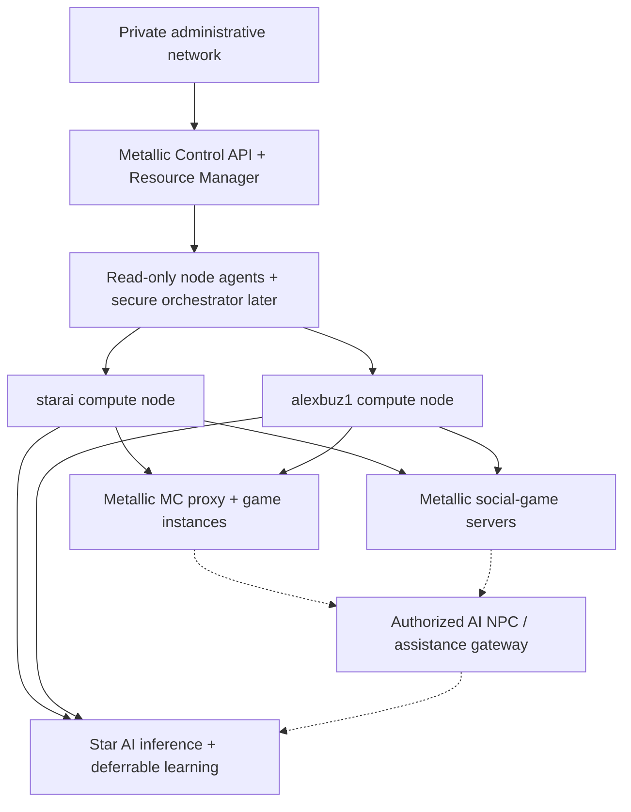

# ADR 0002 — shared infrastructure for Star AI, Metallic and Metallic MC

**Decision:** Adopt a shared hardware resource plane with **separate administrative and execution boundaries per product**, and prioritize latency-sensitive game services over discretionary batch compute. Status: **architecture adopted for design; no host changes deployed**. Updated 2026-10-18.

## Why the original plan must change

The two remotely connected machines already host workloads used by Star AI. We cannot reclaim memory or cores just because a learner is idle. The system must know actual CPU use and pressure, live game demand, disk headroom, backup traffic, and per-project allocations **before** scheduling new processes.

A container is a resource isolation mechanism, not the full definition of a product. A large game network needs **many containers per project**, not one huge Java process. Use distinct namespaces/projects for Star AI, the Metallic social game, Metallic MC and, later, customer hosting. Keep the control plane outside the game processes.

**Data-plane guarantees:** A controller outage must not instantly disconnect active players. Existing game instances keep running until drained or safely restarted. A learning job can be queued for later; it must never forcibly kill a live lobby to take its resources.

## Capacity policy and service classes

| Class | Services | Priority | CPU controls | Admission / recovery |
|---|---|---|---|---|
| **Protected live** | Minecraft match, lobby, Metallic world, public edge, auth | Highest | Dedicated CPU sets where justified; measured tail latency | Reserved capacity; graceful rolling restart and drain; reject admission when low headroom |
| **Core AI** | Star AI chat inference, safety, in-game AI gateway | High | Bounded CPU, RAM and concurrency; model batching where appropriate | Preserve useful chat responsiveness; reject overload or scale down safely |
| **Background AI** | Star AI night-school, evaluation, indexing, future fine-tuning | Low | Capped CPU weights/quotas; burst only on truly idle cores | Start with a budget, checkpoint, pause/defer when live demand rises |
| **Nonurgent** | Build CI, media rendering, backup compression | Low | I/O throttling and constrained memory/CPU | Time-windowed queues and admission, not opportunistic disk floods |
| **Future tenant** | Customer-owned Minecraft servers and mods | **Separate pool** | Enforced per-tenant quota, separate security boundary | No sharing of first-party guaranteed live player capacity |

**Critical:** These priorities are *policy targets*, not enforced by the M0/M0.5 software. The resource planner added this phase is read-only and does not create, boot, stop, preempt, or reserve real containers. Enforcement requires a privileged, authenticated executor with durable reservations and Linux cgroups v2, optionally orchestrated by Nomad. Avoid installing Nomad, Kubernetes, or new Docker daemons over existing Wings until its owner, panel and workload ownership are understood.

### Advisory preview implementation

- `GET /api/v1/resources?profile=mc-lobby` requires authenticated administrator session.
- Built-in what-if profiles: `mc-lobby`, `mc-match`, `metallic-world`, `star-inference`, `star-learning`.
- Each connected node reports CPU threads, CPU utilization, 1-minute load, Linux PSI CPU/memory avg10, RAM, swap, and monitored-disk headroom. Stale/unreported nodes are blocked from preview admission. Historic swap occupancy alone is not proof of active thrashing; PSI is measured separately.
- The planner caps estimated CPU use at 75% for standard/live profiles (40% for batch), sets a 1-logical-core CPU host reserve, and leaves at least 3 GiB or 10% of RAM plus 16 GiB or 10% of the monitored filesystem unused. It rejects high pressure and load. These are **initial conservative heuristics**, not performance benchmarks or a scheduler with quota enforcement.
- Node memory estimates use Linux `MemAvailable` semantics; disk is only the agent-configured mount. CPU busy fraction is an instant observation. None is a guarantee of future capacity, core locality, or NVMe IOPS.
- Older agents without core-count telemetry cannot be admitted. Linux sandbox/test hosts without accessible `/proc/pressure/cpu` and `/proc/pressure/memory` still provide basic metrics but report `pressureAvailable: false`; placement **fails closed** instead of inventing zero pressure. Authorized admin UI says why a candidate is blocked.

### Production resource-manager design (not yet implemented)

1. **Reservations:** per project and node, durable in PostgreSQL with an atomic compare-and-swap or transaction; expire unsafe unconfirmed leases without double-booking capacity. Reconcile process state after crashes.
2. **Enforcement:** per-instance cgroups v2 limits (`cpu.max`, `cpu.weight`, `cpuset.cpus`, `memory.max`, `memory.high`, `io.max`, `pids.max` as appropriate) with explicit host reserves; no Docker socket in untrusted containers. Use the proper container runtime to manage rather than manually editing docker-owned cgroups.
3. **A real autoscaler:** queue lengths, lobby fill ratio, players per instance, startup time, per-mode p95/p99 MSPT and measured CPU/IO. Maintain a small warm capacity buffer; never abruptly destroy an instance hosting players. Cooldown/hysteresis prevent oscillation.
4. **Bursting safely:** only approved, preemptible AI tasks borrow spare CPU/RAM. Training keeps checkpoints and backs off; don't blindly decrease AI priority if it would harm a live player-facing NPC inference request.
5. **Multi-node placement:** account for single-core performance, NUMA, NVMe latency, local/world data, proximity to gateway, measured packet rates and thermal limits. Hardware profiles must come from inventory, not thread count alone.
6. **Quality gates:** restarts, node loss, scheduler restarts, delayed heartbeats, disk saturation, swap storms, backup restore and a 24-hour soak before expanding public capacity.

## Orchestration choices researched

- **Existing Pterodactyl/Pelican Wings + panel:** quickest reuse for game-server lifecycle on a node that already runs Wings. Treat its existing Docker management as owned; integrate with the supported panel APIs rather than a competing daemon modifying its containers. Verify version/administrative authorization before any API changes.
- **Nomad:** flexible lean scheduler for mixed workloads, native Docker driver and CPU core isolation. Worth testing in a *separate lab*, especially if several physical nodes join, but adds operational dependencies. Nomad job `cores` semantics need correct root/cgroup setup.
- **Agones + Kubernetes:** strong Fleet, allocation and game session autoscaling, on-prem friendly, but higher cluster complexity. Particularly appropriate for large ephemeral Metallic social-game match fleets and eventually MC short-lived minigames; not required to launch the first 2-node pilot.
- **Our custom software:** Metallic Control remains the product-specific UI, placement policy, metrics, game matchmaking and Star AI status surface. We should integrate proven engine/runtime primitives rather than build an unaudited Linux container runtime from scratch.

Primary sources: https://pelican.dev/docs/ , https://docs.pterodactyl.io/v2/project/how-it-works , https://docs.hashicorp.com/nomad/docs/architecture/cpu , https://agones.dev/site/docs/overview/ , https://docs.docker.com/engine/containers/resource_constraints .

## Hardware strategy

1. **Immediately:** don't interfere with current Star AI model servers or the already-running Wings service. Verify the real CPU/RAM/disk/ISP inventory, per-process memory peak and existing node privileges. Use read-only diagnostics first.
2. **First game pilot:** a single private Velocity proxy + one Paper lobby only after memory reservation and clean capacity are demonstrated; avoid publicly exposing the home origin. Use Java 25 for supported Minecraft 26.1+.
3. **Performance:** current older AMD EPYC provides many threads, attractive for AI/background and parallel independent game instances; the i7-9700 is a candidate for latency-sensitive small instances if enough RAM becomes available, *pending measured MSPT*.
4. **Upgrade decisions:** prioritise high-single-core-speed CPUs, sufficient ECC RAM, low-latency NVMe for hot worlds, separate backup storage, stable network uplink, UPS, protected game ingress. Don't assume adding RAM or CPU automatically removes single-tick hot spots.
5. **Capacity truth:** player count and server count require controlled benchmarking, not a formula from physical threads; record active entities, chunks, plugins, world shape and client traffic.

## Project status

- **Implemented in source:** read-only planner, five sample workload budgets, Linux PSI and swap telemetry, dashboard Resource Manager, scoped Star AI read-only status endpoint, automated tests.
- **Not implemented:** real resource reservations, cgroup enforcement, auto-boot, persistent store, fair queueing, AI-triggered actions, orchestration integration, DDoS mitigation, Minecraft gameplay stack, Metallic social-game backend.
- **Not performed:** modifications to either physical host, installation, production provisioning, opening ports or stopping a process.
