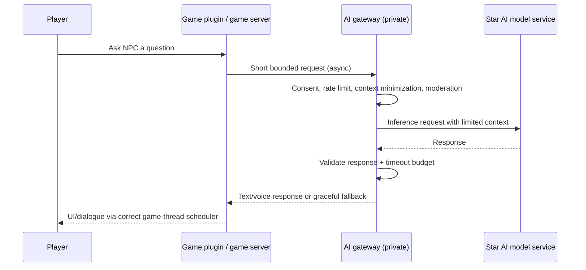

# Star AI <-> Metallic infrastructure + game integration

**Status: read-only integration contract implemented in Metallic Control; Star AI integration and game NPC runtime are future work.**

## Existing Star AI baseline checked

The `oncoursemail/Star-AI` README documents a self-hosted `llama.cpp` model router, optional night-school practice and owner-reviewed lessons. The current night-school feedback process produces candidate *text lessons*, not automatic changes to the model's weights. Therefore it is incorrect to count on continued practice making model inference stop consuming RAM or CPU. Optimize routing/caching/quantization and defer background jobs instead.

## Read-only observation contract: implemented

Opt in with an independently generated secret in **Metallic Control's runtime environment**:

```bash
export METALLIC_STARAI_READ_TOKEN="$(openssl rand -hex 32)"
```

The same secret must be provisioned to Star AI through its secure credential store, never committed to Git or shown to game players. Over the private management VPN / encrypted channel only:

```http
GET /api/v1/ai/context HTTP/1.1
Authorization: Bearer <YOUR_SEPARATELY_PROVISIONED_TOKEN>
```

Returns a stable, read-only JSON shape with `stage`, `serverTime`, `readOnly`, `deploymentImplemented`, `nodes` and `exampleAdmission`. Nodes expose IDs, online states, CPU/threads, available RAM and CPU pressure. Does **not** return admin password, node ingestion token, physical hostnames, private IP addresses, proxy backend list, arbitrary shell access or game player identities. An unset token disables the endpoint (404); a wrong or agent token is rejected (401). Admin session cookies cannot substitute for the separate token.

Important: the response is an **observation**, not a command authorization. Star AI may explain utilization or propose a GitHub change, but cannot provision a server by calling this endpoint. Automatic command execution will require a separate action policy, approvals, signed jobs, RBAC/MFA, audit, rollback and hard-coded allowlisted operations.

## Follow-up: integration inside Star AI

1. Add an opt-in "Metallic infrastructure" status tool in Star AI's app and Discord bot. Poll only when requested or at a bounded interval; do not inject sensitive metrics into third-party LLM prompts by default.
2. Show node status, resource warnings, deployment state and progress tied to **real** jobs rather than generic "coding" or "studying" status strings.
3. Add a **learning scheduler gate** using protected gameplay load and CPU/memory pressure; checkpoint/defer Star AI practice/evaluation jobs when active matches are consuming their reserved resource pools.
4. Build a coding companion workflow: propose change -> branch + PR -> run static tests/game simulations -> review -> staged rollout -> observe -> rollback on regression. Star AI must not silently change its own grader, evaluation suites or production server files.

## Later: Star AI inside Metallic Minecraft and Metallic (social game)

**Do not run an LLM inference call synchronously on Minecraft's main/region thread or social-game frame loop.**



Capabilities to explore: helpful NPCs and educators, creator tutorials, contextual quests, dynamically narrated events, translation, accessibility, user-created workshop assistants, staff debugging assistants **for authorized staff only**. Different limits are required for kids' accounts and public chat. Avoid collecting private conversations as automatic "training" data without notice/consent; minimise retention. Apply safety filters and human moderation escalation.

**Technical constraints:** async request budget, per-player/team quota, bounded response length, cache repeated informational replies, 1–3 second soft timeout with graceful fallback, no direct write access from AI to block/world objects, integrate Paper vs Folia scheduling correctly, never send the game server's token to the client, and prevent prompt injection from granting admin privileges. Multiplayer AI assistants should be separate resource-constrained services so a model spike cannot lengthen a world tick.
